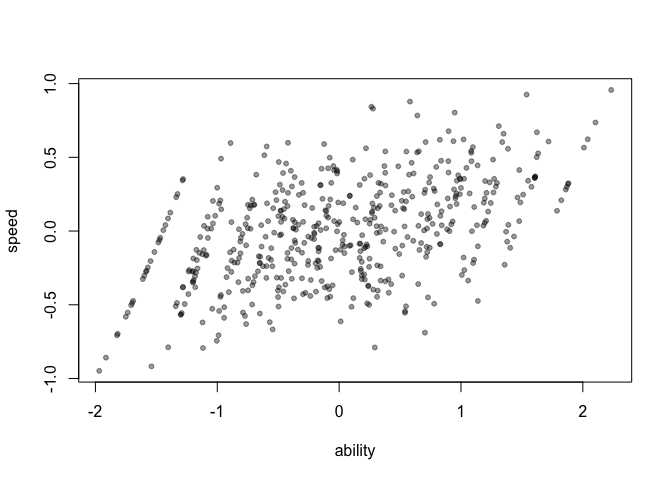
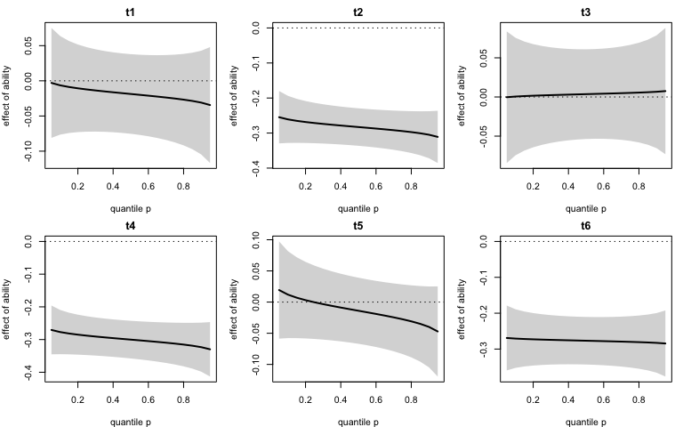
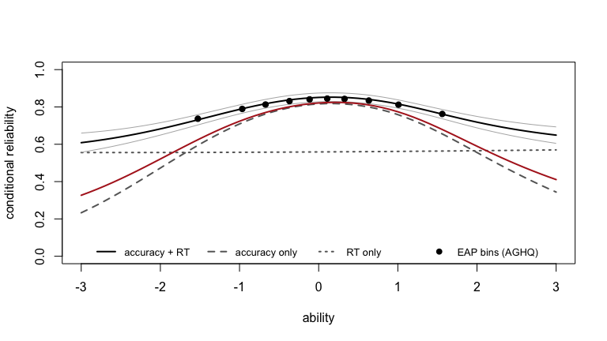
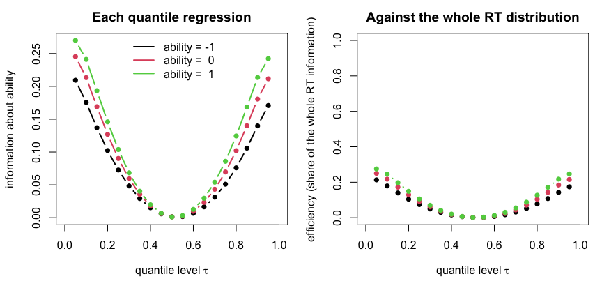
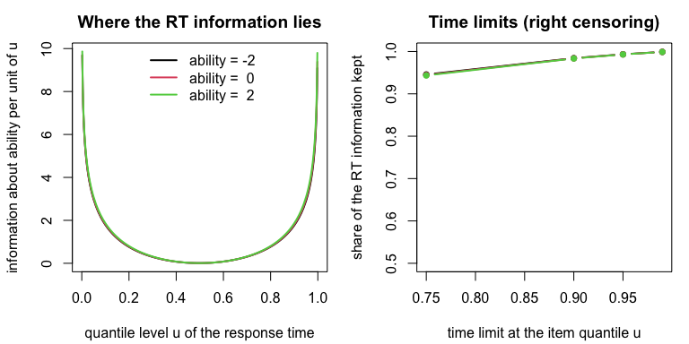
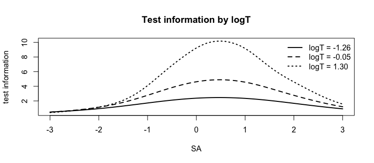
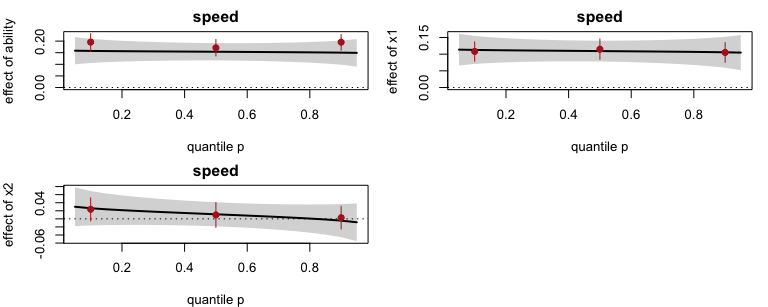

# birt 使用教學
Jie-Wen Tsai
2026-10-29

- [0. 安裝與名詞](#0-安裝與名詞)
- [1. 快速開始：第一個 ELGM 模型](#1-快速開始第一個-elgm-模型)
- [2. 語法規則與先驗](#2-語法規則與先驗)
- [3. 物件與輸出](#3-物件與輸出)
- [4. 模型比較](#4-模型比較)
- [5. 潛在迴歸](#5-潛在迴歸)
- [6. 分配模型與分位數](#6-分配模型與分位數)
- [7. 最大概似工具（`method = "aghq"`）](#7-最大概似工具method--aghq)
- [8. Likert 量表加總作答時間：調節 GRM（`ordered = TRUE`）](#8-likert-量表加總作答時間調節-grmordered--true)
- [9. JAGS 引擎（選配）](#9-jags-引擎選配)
- [10. 常見問題](#10-常見問題)
- [參考文獻](#參考文獻)

這份教學寫給想分析「作答正確性 + 作答時間」的學生與研究者，修過基礎統計、用過 R 就能讀。 我們從安裝開始，一步一步配適作答反應加作答時間的模型。

**只想先跑出第一個結果：** 讀第 1 節的 1.1–1.5（`rtirt_syntax()` → `birt()` → `summary()` → `scores()`），再看第 4 節的 `compare()`。其他各節用到時再查。

**我想知道……該用什麼：**

| 我想知道 | 用什麼 | 教學位置 |
|----|----|----|
| 能力和速度有沒有相關 | `rtirt_syntax()` 寫模型，`summary()` 的 `ability ~~ speed` | 1.2–1.4 |
| 每個人的能力、速度分數 | `scores()`、`reliability()` | 1.5 |
| 哪個模型比較好 | `compare()` | 4 |
| 題目有沒有 DIF（對某一組不公平） | 最大概似配適，再用 `score_test()` 或 `ipcr()`；找到後在語法加 `E(y3) ~ x2` | 7.1、7.3 |
| 共變項對速度、能力的影響 | `rtirt_syntax(structure = "path", cov = )`，或語法 `speed ~ x1` | 5 |
| 要 p 值、AIC、BIC | 同一個模型改用最大概似：`control = rtmb_control(method = "ml")` | 4.2、7 |

**這份教學的主線是 ELGM。**

- `birt(model, data)` 預設用 RTMB 引擎做 ELGM，也就是近似貝氏推論。
- 需要分數檢定（score test）、AIC、BIC 時，改用同一個邊際概似的最大概似估計。
- JAGS 引擎是選配，只有少數功能需要它（第 9 節）。

**每段程式之後都有兩張清單：**

- **逐行說明**：每一行程式在做什麼。
- **輸出怎麼讀**：輸出裡每一塊的意思，以及數字怎麼解讀。

**程式與輸出：** 文中的程式都實際執行過。 輸出中印出的秒數會隨電腦負載改變；文中提到的時間是在同一台電腦上單獨執行時的大約值。 資料是模擬資料（`sim_rtirt()`、`sim_hgrm()`），所以任何電腦都能重現。 JAGS 的鏈數與迭代數刻意設小，只為了讓文件跑得快；實際分析請用預設值。

**實際資料的結果：** 標明「TIMSS」或「SEL」的表格來自兩份資料的完整分析，不在本文件中執行。

- TIMSS 2019 臺灣：N = 631，14 題數學，每題都有作答時間。
- SEL 量表：N = 1068，30 題四點量表，每人只有一個總作答時間。

**符號：** 本文一律用 j 表示受試者（person），i 表示題目（item）。

## 0. 安裝與名詞

### 0.1 安裝

``` r
install.packages("remotes")
remotes::install_github("jiewenTsai/birt")
# 選配：JAGS 引擎（另外要先裝 JAGS 4.3 以上）
install.packages("R2jags")
```

逐行說明：

1.  安裝 remotes 套件（用來從 GitHub 安裝）。
2.  從 GitHub 安裝 birt，和英文 README 相同。相依套件（RTMB、lavaan、statmod、coda、loo 等）會一起裝好。RTMB 是 ELGM 與最大概似的計算核心。
3.  註解：下一行是選配。
4.  R2jags 只在 `engine = "jags"` 時需要；它還需要先從 <https://mcmc-jags.sourceforge.io/> 安裝 JAGS 程式本身。

如果拿到的是老師或作者提供的原始碼檔（例如 `birt_0.2.0.tar.gz`），沒有網路時可以改用 `install.packages(c("RTMB", "lavaan", "statmod", "coda", "loo"))` 先裝相依套件，再用 `install.packages("birt_0.2.0.tar.gz", repos = NULL, type = "source")` 安裝。

輸出怎麼讀：

- 這段不在文件中執行，沒有輸出。
- 安裝成功時，R 只會顯示下載與編譯的訊息。

### 0.2 名詞表

下面的名詞在後文第一次出現時也會再解釋。

| 名詞 | 意思 |
|----|----|
| 潛在變項 | 無法直接觀察的特質，例如能力（ability）與速度（speed）。每個受試者 j 有自己的值 θ_j。 |
| 條件概似（conditional likelihood） | 把每個人的潛在變項值當成已知時，資料的機率 p(y \| θ, ψ)。ψ 是題目參數等其他參數。 |
| 邊際概似 L(ψ)（marginal likelihood） | 把每個人的潛在變項積分掉之後的資料機率 ∫ p(y \| θ, ψ) p(θ \| ψ) dθ。它只是 ψ 的函數。輸出中的 `logLik`、`-2logL` 都指它。 |
| AGHQ | 適應性 Gauss–Hermite 積分（adaptive Gauss–Hermite quadrature）。在每個人的後驗眾數附近放少數節點，用加權和近似上面的積分。 |
| 最大概似（ML） | 找出讓邊際概似最大的 ψ。不用先驗。birt 寫成 `rtmb_control(method = "aghq")`，也可以寫 `method = "ml"`（同一件事）。 |
| ELGM | 延伸潛在高斯模型（extended latent Gaussian model；Stringer, Brown & Stafford, 2023）的近似貝氏推論。內層用 AGHQ 把每個人積掉，外層對其餘參數的後驗再做一次適應性積分。birt 的預設。 |
| 先驗（prior） | 看資料之前對參數的假設分配。ELGM 與 JAGS 都會用；最大概似不用。 |
| 後驗平均數、後驗 SD | 看過資料後，參數分配的平均數與標準差。ELGM 的 `est` 與 `se` 就是這兩個量（在貝氏配適裡，`se` 欄放的是後驗 SD）。 |
| 95% 可信區間 | 後驗分配中間 95% 的範圍。輸出中的 `lower`、`upper`（`summary()` 的表上是 `pi.lower`、`pi.upper`）。 |
| 模型證據 p(y)（輸出叫 log marginal likelihood，`logML`） | 把 L(ψ) 再對參數 ψ 依先驗積分：log p(y) = log ∫ L(ψ) p(ψ) dψ。ELGM 的外層積分順便算出它。它和 log L(ψ) 不是同一個數。 |
| 超參數（hyperparameter） | 控制潛在變項分配的少數參數，例如 speed 的 SD、ability 與 speed 的相關、SHASH 的形狀、`V(f) ~ z` 的調節效果。ELGM 的外層只在這些方向放積分節點。 |
| 潛在高斯場 W | ELGM 中先被積分掉的那一組常態潛在變項。birt 的 W 只包含每個人的潛在變項。 |
| Laplace 近似 | 用眾數處的二次展開（常態近似）代替積分。AGHQ 只用 1 個節點時就是 Laplace 近似。 |
| NUTS | 一種 Hamiltonian MCMC 抽樣法（Stan 使用的方法）；tmbstan 讓 RTMB／TMB 模型用 Stan 抽樣。本文用它當「標準答案」核對 ELGM。 |
| Bayes factor（BF） | 兩個模型 p(y) 的比值。BF = 10 表示資料在模型 A 下的機率是模型 B 的 10 倍。 |
| EAP | 後驗期望值（expected a posteriori），每個人潛在變項的後驗平均數。`scores()` 給 EAP 與後驗 SD（PSD）。 |
| 信度 | birt 的 EAP 信度 = var(EAP) / (var(EAP) + mean PSD²)。 |

``` r
library(birt)
```

逐行說明：

1.  載入 birt。RTMB 引擎在需要時自動載入，不必另外 `library(RTMB)`。

輸出怎麼讀：

- 沒有輸出代表載入成功。

## 1. 快速開始：第一個 ELGM 模型

### 1.1 資料

``` r
d <- sim_rtirt(N = 500, K = 10, seed = 1)
head(round(d[, c("y1", "y2", "t1", "t2", "x1", "x2")], 2), 3)
```

      y1 y2   t1   t2    x1    x2
    1  1  1 3.06 2.69 -0.63  0.08
    2  1  1 4.79 3.24  0.18 -0.30
    3  0  1 3.15 3.79 -0.84 -1.18

逐行說明：

1.  `sim_rtirt()` 模擬 500 人、10 題的資料。每題有答對與否 `y1`–`y10`（0/1），以及 log 作答時間 `t1`–`t10`。`x1`、`x2` 是兩個標準常態的共變項。
2.  只看前 3 人、6 個欄位，四捨五入到小數兩位。

輸出怎麼讀：

- 每一列是一個受試者 j。
- `y1`、`y2` 是 0 或 1。
- `t1`、`t2` 已經取過 log，所以大約在 2.5–5 之間（約 12–150 秒）。
- 模擬的真值：ability 與 speed 本身互相獨立（相關為 0）。奇數題的 log 時間和能力無關；偶數題的 log 時間會隨能力變短（交叉負荷 −0.3）。後面的模型比較會用到這一點。

### 1.2 寫模型

``` r
items <- paste0("y", 1:10)
times <- paste0("t", 1:10)
model <- rtirt_syntax(items, times)
cat(model)
```

    ability =~ y1 + y2 + y3 + y4 + y5 + y6 +
             y7 + y8 + y9 + y10
    speed =~ -1*t1 + -1*t2 + -1*t3 + -1*t4 + -1*t5 + -1*t6 +
             -1*t7 + -1*t8 + -1*t9 + -1*t10
    ability ~~ speed

逐行說明：

1.  作答題的欄名 `y1`–`y10`。
2.  作答時間的欄名 `t1`–`t10`。
3.  `rtirt_syntax()` 依欄名寫出常用的 RT-IRT 語法。預設是 van der Linden（2007）的階層模型。
4.  印出語法。

輸出怎麼讀：

- **第一行 `ability =~ y1 + ...`：** `ability` 的測量負荷量。二元題用 logit 連結。
- **第二行 `speed =~ -1*t1 + ...`：** `speed` 的負荷量都固定為 −1。speed 越高，log 時間越短。這就是對數常態作答時間模型。
- **第三行 `ability ~~ speed`：** 兩個潛在變項的相關。
- 語法沿用 lavaan：`=~` 是「由……測量」，`~~` 是共變，`~` 是迴歸。
- birt 有一個專屬規則：一個因素的 `=~` 若寫在**另一個因素**的 `=~` 之後，就是交叉負荷（例如先寫 `speed =~ ...`，再寫 `ability =~ t1`；1.6 節、第 2 節）。同一個因素連續寫兩行（中間沒有別的因素）只是換行，仍是測量負荷量，和 lavaan 一樣。

### 1.3 配適

``` r
fit <- birt(model, data = d)
fit
```

    birt 0.2.0, RTMB engine: marginal likelihood (persons integrated out)
      500 persons; latent variables: ability, speed
      Distributions: ability: normal; speed: normal; 10 continuous: normal (10); 10 binary: logit
      Approximate Bayes (ELGM; W = person latents): 42 parameters; 28 s
        inner: AGHQ (k = 9) per person; outer: AGHQ, k = 9 on log sd(speed), atanh cor(ability, speed), Gaussian in 40 directions (81 nodes)
      log marginal likelihood -6883.73; -2logL at the posterior mode 13448.7
      Reliability: ability 0.760, speed 0.861
    Use summary() for the parameter table, scores() for the person scores and plot() for a plot of them.

逐行說明：

1.  用預設設定配適：RTMB 引擎、`method = "elgm"`。在這台電腦上大約 20 秒。
2.  印出簡短的概覽。

輸出怎麼讀：

- **`RTMB engine: marginal likelihood (persons integrated out)`：** 用的是邊際概似，每個人的潛在變項已經積分掉。
- **`Distributions`：** 兩個潛在變項都是常態；10 個連續指標（log 時間）殘差為常態；10 個二元題用 logit。
- **`Approximate Bayes (ELGM; W = person latents): 42 parameters`：** ELGM 的潛在高斯場 W 只放每個人的潛在變項；其餘 42 個參數由外層處理。
- **`inner: AGHQ (k = 9) per person`：** 內層。每人用 9 × 9 個節點積掉 (ability, speed)。兩個潛在變項時預設 k = 9；只有一個潛在變項時預設 k = 21（第 8 節）。
- **`outer: AGHQ, k = 9 on log sd(speed), atanh cor(ability, speed)`：** 外層。在兩個超參數方向各放 9 個節點：speed 的 log SD，與相關的 atanh 轉換（內部名稱 `lsd2`、`atr`，`rtmb_control(hyper = )` 用的就是這兩個名字）。
- **`Gaussian in 40 directions (81 nodes)`：** 其餘 40 個題目參數用高斯近似；外層總共 9 × 9 = 81 個節點。
- **`log marginal likelihood -6883.73`：** 模型證據 log p(y)，模型比較用（第 4 節）。
- **`-2logL at the posterior mode 13448.7`：** 在後驗眾數處的 −2 log L(ψ)。它除以 −2 是 −6724.34，和 logML 不同：logML 還包含了對參數的積分與先驗。
- **`Reliability`：** ability 的 EAP 信度 .760，speed 為 .861。
- `inner`、`outer` 兩行是計算細節，第一次讀可以跳過；下面的「進階」框說明外層怎麼選方向。

> [!NOTE]
> **進階：外層的超參數怎麼選**
>
> birt 自動挑選（`rtmb_control(hyper = "auto")`）。speed 是 SHASH 時，取它的形狀參數；否則取潛在變項的相關、路徑與 SD（含 `V(f) ~ z`）。自動挑選最多 3 個方向，多出來的改用高斯近似，並印出訊息說明（4 個方向要 5⁴ = 625 個節點，外層時間約是 3 個方向的 5 倍，結果幾乎相同）。每個方向的節點數依方向數而定：1 個方向 11 個，2 個方向 9 個，3 個方向 5 個；自己用 `hyper =` 指定更多方向時，4 個方向 5 個，更多時 3 個。

### 1.4 參數表：`summary()`

``` r
summary(fit)
```

    birt 0.2.0, RTMB engine: marginal likelihood (persons integrated out)
      500 persons; latent variables: ability, speed
      Distributions: ability: normal; speed: normal; 10 continuous: normal (10); 10 binary: logit
      Approximate Bayes (ELGM; W = person latents): 42 parameters; 28 s
        inner: AGHQ (k = 9) per person; outer: AGHQ, k = 9 on log sd(speed), atanh cor(ability, speed), Gaussian in 40 directions (81 nodes)
      log marginal likelihood -6883.73; -2logL at the posterior mode 13448.7

    $fit  log marginal likelihood (ELGM)
      N  method                                             npar      logML  logLik_mode  Deviance_mode  nodes  ESS_nodes
    500  ELGM: AGHQ (k = 9) inner, AGHQ (k = 9) on 2 outer    42  -6883.730    -6724.339      13448.677     81     11.989

    $items  item parameters (posterior means); binary items also as IRT a, b = -d / a
    item  type        ability   speed  intercept  resid_var      a       b
    y1    binary        1.025              0.701             1.025  -0.683
    y2    binary        1.242              0.077             1.242  -0.062
    y3    binary        1.009             -1.252             1.009   1.241
    y4    binary        0.863             -1.935             0.863   2.243
    y5    binary        1.847             -0.181             1.847   0.098
    y6    binary        1.135             -0.270             1.135   0.237
    y7    binary        2.121             -1.132             2.121   0.533
    y8    binary        1.789              0.243             1.789  -0.136
    y9    binary        1.351             -0.408             1.351   0.302
    y10   binary        1.234              0.815             1.234  -0.660
    t1    continuous           -1.000      4.378      0.234
    t2    continuous           -1.000      3.816      0.181
    t3    continuous           -1.000      3.738      0.249
    t4    continuous           -1.000      4.047      0.222
    t5    continuous           -1.000      4.421      0.194
    t6    continuous           -1.000      3.483      0.329
    t7    continuous           -1.000      3.757      0.209
    t8    continuous           -1.000      3.761      0.212
    t9    continuous           -1.000      4.142      0.314
    t10   continuous           -1.000      4.728      0.184

    $se  posterior SDs of the item parameters (the table is $se for every fit)
    item  type        ability  speed  intercept  resid_var      a      b
    y1    binary        0.152             0.117             0.152  0.131
    y2    binary        0.166             0.116             0.166  0.094
    y3    binary        0.157             0.132             0.157  0.183
    y4    binary        0.166             0.158             0.166  0.374
    y5    binary        0.238             0.141             0.238  0.076
    y6    binary        0.156             0.114             0.156  0.102
    y7    binary        0.286             0.181             0.286  0.080
    y8    binary        0.231             0.139             0.231  0.078
    y9    binary        0.178             0.123             0.178  0.093
    y10   binary        0.173             0.127             0.173  0.114
    t1    continuous                      0.027      0.016
    t2    continuous                      0.025      0.013
    t3    continuous                      0.028      0.017
    t4    continuous                      0.027      0.015
    t5    continuous                      0.026      0.014
    t6    continuous                      0.030      0.022
    t7    continuous                      0.026      0.015
    t8    continuous                      0.026      0.015
    t9    continuous                      0.030      0.021
    t10   continuous                      0.025      0.013

    $parameters  approximate posterior (ELGM): mean, SD and 95% interval; prior of each parameter

    Latent Variables:
                        Estimate  Post.SD  pi.lower  pi.upper  Prior
      ability =~
        y1                 1.025    0.152     0.767     1.371  hier(ability)
        y2                 1.242    0.166     0.955     1.614  hier(ability)
        y3                 1.009    0.157     0.743     1.370  hier(ability)
        y4                 0.863    0.166     0.591     1.259  hier(ability)
        y5                 1.847    0.238     1.435     2.378  hier(ability)
        y6                 1.135    0.156     0.867     1.487  hier(ability)
        y7                 2.121    0.286     1.629     2.763  hier(ability)
        y8                 1.789    0.231     1.390     2.303  hier(ability)
        y9                 1.351    0.178     1.044     1.748  hier(ability)
        y10                1.234    0.173     0.938     1.623  hier(ability)
      speed =~
        t1                -1.000
        t2                -1.000
        t3                -1.000
        t4                -1.000
        t5                -1.000
        t6                -1.000
        t7                -1.000
        t8                -1.000
        t9                -1.000
        t10               -1.000

    Covariances (correlations):
                        Estimate  Post.SD  pi.lower  pi.upper  Prior
      ability ~~
        speed              0.424    0.048     0.326     0.515  dunif(-1, 1)

    Variances:
                        Estimate  Post.SD  pi.lower  pi.upper  Prior
        ability            1.000
        speed              0.137    0.010     0.118     0.158  on SD: dt(0, 1, 3) T(0,)
        t1                 0.234    0.016     0.204     0.267  on SD: dt(0, 1, 3) T(0,)
        t2                 0.181    0.013     0.158     0.209  on SD: dt(0, 1, 3) T(0,)
        t3                 0.249    0.017     0.218     0.285  on SD: dt(0, 1, 3) T(0,)
        t4                 0.222    0.015     0.194     0.255  on SD: dt(0, 1, 3) T(0,)
        t5                 0.194    0.014     0.169     0.222  on SD: dt(0, 1, 3) T(0,)
        t6                 0.329    0.022     0.288     0.375  on SD: dt(0, 1, 3) T(0,)
        t7                 0.209    0.015     0.182     0.239  on SD: dt(0, 1, 3) T(0,)
        t8                 0.212    0.015     0.185     0.244  on SD: dt(0, 1, 3) T(0,)
        t9                 0.314    0.021     0.275     0.358  on SD: dt(0, 1, 3) T(0,)
        t10                0.184    0.013     0.160     0.212  on SD: dt(0, 1, 3) T(0,)

    Intercepts:
                        Estimate  Post.SD  pi.lower  pi.upper  Prior
        y1                 0.701    0.117     0.472     0.929  dnorm(0, 1/9)
        y2                 0.077    0.116    -0.151     0.305  dnorm(0, 1/9)
        y3                -1.252    0.132    -1.511    -0.994  dnorm(0, 1/9)
        y4                -1.935    0.158    -2.245    -1.625  dnorm(0, 1/9)
        y5                -0.181    0.141    -0.457     0.095  dnorm(0, 1/9)
        y6                -0.270    0.114    -0.492    -0.047  dnorm(0, 1/9)
        y7                -1.132    0.181    -1.486    -0.777  dnorm(0, 1/9)
        y8                 0.243    0.139    -0.030     0.515  dnorm(0, 1/9)
        y9                -0.408    0.123    -0.649    -0.166  dnorm(0, 1/9)
        y10                0.815    0.127     0.565     1.064  dnorm(0, 1/9)
        t1                 4.378    0.027     4.325     4.431  dnorm(0, 1/100)
        t2                 3.816    0.025     3.766     3.865  dnorm(0, 1/100)
        t3                 3.738    0.028     3.684     3.792  dnorm(0, 1/100)
        t4                 4.047    0.027     3.994     4.099  dnorm(0, 1/100)
        t5                 4.421    0.026     4.371     4.471  dnorm(0, 1/100)
        t6                 3.483    0.030     3.423     3.543  dnorm(0, 1/100)
        t7                 3.757    0.026     3.706     3.809  dnorm(0, 1/100)
        t8                 3.761    0.026     3.709     3.813  dnorm(0, 1/100)
        t9                 4.142    0.030     4.084     4.201  dnorm(0, 1/100)
        t10                4.728    0.025     4.678     4.777  dnorm(0, 1/100)

    Approximate Bayes (ELGM): posterior SDs and 95% credible intervals, no p-values. For p-values and AIC / BIC, fit by maximum likelihood: birt(..., control = rtmb_control(method = "ml"))

    $reliability  reliability of the EAP scores: var(EAP) / (var(EAP) + mean PSD^2)
    ability  speed
      0.760  0.861

逐行說明：

1.  `summary()` 一次算好所有表格並印出。

輸出怎麼讀（依出現順序）：

- **`$fit`：** `logML` 是 log 邊際概似；`logLik_mode` 與 `Deviance_mode` 是後驗眾數處的 log 概似與 −2 倍；`nodes` 是外層節點數；`ESS_nodes` 是外層節點的有效個數（權重越集中，數字越小）。
- **`$items`：** 每題一列的後驗平均數。二元題另外換算成 IRT 參數：`a` 等於負荷量，`b` = −截距 / a。例如 y4 的 `b` = 2.243，是最難的一題。
- **`$se`：** 與 `$items` 同版面的後驗 SD。
- **`$parameters`：** lavaan 式分段表。
  - `Estimate` 是後驗平均數，`Post.SD` 是後驗 SD，`pi.lower`、`pi.upper` 是 95% 可信區間，`Prior` 是先驗。
  - `ability =~ y1` 的先驗 `hier(ability)` 是階層 lognormal 先驗：同一因素的負荷量共用一個平均數 μ。
  - `ability ~~ speed` 的估計 0.424 是相關，95% 區間 \[0.326, 0.515\]。真正的相關是 0；相關模型沒有交叉負荷，只好把偶數題「能力高、做得快」的效果吸收成 0.424 的相關。
  - `Variances` 段中，`speed` 是速度的變異數（0.137）；`t1`–`t10` 是各題 log 時間的殘差變異數。先驗 `on SD: dt(0, 1, 3) T(0,)` 是對 **SD**（不是變異數）的半 t 分配（自由度 3）。
  - `Intercepts` 段：二元題是 logit 截距，時間題是平均 log 時間。
  - 表的最後一行提醒：ELGM 是近似貝氏，沒有 p 值；要 p 值與 AIC/BIC，用最大概似配適（`control = rtmb_control(method = "ml")`，第 7 節）。
- **`$reliability`：** EAP 信度。

### 1.5 個人分數與信度

``` r
head(scores(fit), 3)
```

    # A tibble: 3 × 5
         id ability ability_psd speed speed_psd
      <int>   <dbl>       <dbl> <dbl>     <dbl>
    1     1   0.896       0.473 0.474     0.137
    2     2   1.82        0.600 0.209     0.138
    3     3  -0.423       0.462 0.169     0.137

``` r
reliability(fit)
```

     ability    speed 
    0.760325 0.861471 

逐行說明：

1.  `scores()` 給每個人的 EAP 與後驗 SD，這裡只看前 3 人。
2.  `reliability()` 給每個潛在變項的 EAP 信度。

輸出怎麼讀：

- `id` 是受試者編號（沒有給 `id =` 時是 1..N）。
- `ability`、`speed` 是 EAP；`ability_psd`、`speed_psd` 是後驗 SD。
- ELGM 的 EAP 是所有外層節點上 EAP 的加權平均，所以已經考慮了題目參數的不確定性。
- 信度和 `fit` 印出的數字相同：ability .760、speed .861。

``` r
plot(fit)
```



逐行說明：

1.  這個模型沒有隨分位數改變的效果（沒有 `V()` 或 `shash()`），所以 `plot()` 畫兩個潛在變項的 EAP 散布圖（`type = "scores"`）。`plot(fit, type = "information")` 畫測驗訊息：全部指標、只有作答正確性、只有作答時間，對 ability 各提供多少訊息。

輸出怎麼讀：

- 每一點是一個人：橫軸是 ability 的 EAP，縱軸是 speed 的 EAP。點雲往右上傾斜，就是正相關。

### 1.6 `rtirt_syntax()` 的其他選項

``` r
cat(rtirt_syntax(items, times, cross = "free"))
```

    ability =~ y1 + y2 + y3 + y4 + y5 + y6 +
             y7 + y8 + y9 + y10
    speed =~ -1*t1 + -1*t2 + -1*t3 + -1*t4 + -1*t5 + -1*t6 +
             -1*t7 + -1*t8 + -1*t9 + -1*t10
    ability =~ t1 + t2 + t3 + t4 + t5 + t6 +
             t7 + t8 + t9 + t10

``` r
cat(rtirt_syntax(items, times, structure = "path", cov = c("x1", "x2")))
```

    ability =~ y1 + y2 + y3 + y4 + y5 + y6 +
             y7 + y8 + y9 + y10
    speed =~ -1*t1 + -1*t2 + -1*t3 + -1*t4 + -1*t5 + -1*t6 +
             -1*t7 + -1*t8 + -1*t9 + -1*t10
    speed ~ ability + x1 + x2

逐行說明：

1.  `cross = "free"`：每一題的 log 時間都有一個 ability 的交叉負荷（Bolsinova & Tijmstra, 2018）。
2.  `structure = "path"`：用迴歸 `speed ~ ability` 取代相關；`cov =` 把共變項加進潛在迴歸。

輸出怎麼讀：

- 第一段多了一行 `ability =~ t1 + ... + t10`。它寫在 `speed =~` 之後，所以是**交叉負荷**：能力對 log 時間的直接效果。這時沒有 `ability ~~ speed`，因為所有題目共同的交叉負荷就等於相關（見第 4 節）。
- 第二段最後一行 `speed ~ ability + x1 + x2` 是潛在迴歸：速度對能力與兩個共變項的迴歸。

| 參數 | 選項 |
|----|----|
| `cross` | `"none"`、`"free"`、`"ssp"`（spike-and-slab，只限 JAGS） |
| `structure` | `"cor"`、`"path"`、`"none"`；有交叉負荷時只能 `"none"` |
| `cov`、`cov_on` | 潛在迴歸的共變項，以及迴歸到 `"speed"`（預設）、`"ability"` 或 `"both"` |
| `speed_var = "fixed"` | 加上 `speed ~~ 1*speed`（對 log 秒數通常過度限制） |

### 1.7 真實資料：原始秒數、ID 與防呆

真實資料的時間通常是秒數，而且每個人有 ID：

``` r
items <- grep("^ME[0-9]+$", names(raw), value = TRUE)
times <- paste0(items, "_S")
fit <- birt(rtirt_syntax(items, times), raw, log_rt = TRUE, id = "IDSTUD")
head(scores(fit))
```

逐行說明：

1.  找出 TIMSS 式的題目欄名（例如 `ME62344`）。
2.  對應的作答秒數欄名（例如 `ME62344_S`）。
3.  `log_rt = TRUE`：連續指標是秒數，先取 log 再配適（欄名不變）；`id = "IDSTUD"`：用這一欄當受試者編號。
4.  `scores()` 的 `id` 欄就是 IDSTUD。

輸出怎麼讀：

- 這段不執行（`raw` 是你自己的資料）。
- 只有部分連續指標是時間時，改給欄名，例如 `log_rt = times`。`summary()` 會標明哪些欄位取過 log。

常見的資料錯誤會在配適之前被擋下或警告：

``` r
d12 <- d
d12$y1 <- d12$y1 + 1
birt(model, d12)
```

    Error: two-valued indicators not coded 0/1 (y1: 1/2); binary items must be 0/1, e.g. data$y1 <- data$y1 - 1

``` r
dsec <- d
for (v in times) dsec[[v]] <- exp(dsec[[v]])
invisible(capture.output(rtmb_code(model, data = dsec, estimate = FALSE)))
```

    Warning: continuous indicators look like raw response times (positive,
    right-skewed, median > 10: t1, t2, t3, t4, ...); the model assumes normal
    residuals, so log-transform them: birt(..., log_rt = TRUE)

逐行說明：

1.  複製一份資料。
2.  把 y1 改成 1/2 編碼（常見的匯入錯誤）。
3.  嘗試配適：會在估計之前就停下。
4.  再複製一份資料。
5.  把 log 時間轉回秒數，模擬「忘了取 log」。
6.  `rtmb_code(..., estimate = FALSE)` 只檢查資料、產生程式碼，不估計；`capture.output()` 把產生的程式碼藏起來，只留下警告。

輸出怎麼讀：

- **Error：** y1 只有 1、2 兩個值，不是 0/1。訊息直接告訴你怎麼改：`data$y1 <- data$y1 - 1`。
- **Warning：** 連續指標都是正數、右偏、中位數大於 10，看起來像原始秒數。模型假設殘差常態，所以請用 `log_rt = TRUE`。
- `birt()` 會給同樣的警告；這裡用 `rtmb_code()` 只是為了不必真的配適。

## 2. 語法規則與先驗

| 寫法 | 意思 | 預設先驗 |
|----|----|----|
| `f =~ y1 + y2` | 每個因素最前面的 `=~`（連續寫成好幾行也算）：測量負荷量 | 階層 lognormal（正）：log λ_i ~ N(μ_f, 1)，μ_f ~ N(0, 10)（10 是變異數，SD 3.16；JAGS 寫法 `dnorm(0, 0.1)`） |
| `f =~ t1 + t2`（寫在另一個因素的 `=~` 之後） | 交叉負荷 | `dnorm(0, 1)` |
| `f =~ -1*t1` | 固定值 | — |
| `f =~ r*t1 + r*t2` | 相同標籤代表同一個參數 | — |
| `f =~ prior("dnorm(0, 100)")*t1` | 逐一自訂先驗（**精確度**參數化） | — |
| `f =~ prior("ssp")*t1` | spike-and-slab（只限 JAGS，第 9 節） | — |
| `f1 ~~ f2` | 因素相關 | `dunif(-1, 1)` |
| `f ~~ 1*f` | 固定（殘差）變異數 | — |
| `f ~ x1 + x2` | 潛在迴歸 | `dnorm(0, 1)` |
| `f2 ~ f1` | 兩個潛在變項之間的路徑 | `dnorm(0, 1)` |
| `E(y3) ~ x2` | 題目 y3 的難度（截距）隨 x2 改變：均一 DIF（7.3 節有完整例子） | `dnorm(0, 1)` |
| `E(y3) ~ x2:f` | 題目 y3 的鑑別度（負荷量）隨 x2 改變：非均一 DIF（第 8 節） | `dnorm(0, 1)` |
| `V(t1) ~ f` | t1 的殘差 SD 隨 f 改變（第 6 節）；`E()`、`V()` 要大寫 | `dnorm(0, 1)` |

**識別由套件自動處理：**

- 有自由負荷量的因素（例如 ability），變異數固定為 1。
- 負荷量全部固定的因素（例如 speed），變異數自由估計。
- 兩個因素預設不相關；要相關請寫 `ability ~~ speed`。

### 2.1 預設先驗：`dpriors()`

先驗的寫法沿用 JAGS：常態分配用**精確度**（1/變異數）參數化，所以 `dnorm(0, 1/9)` 代表 SD 3，`dnorm(0, 100)` 代表 SD 0.1。

``` r
dpriors()
```

    parameter         prior
    loading           hier
    cross             dnorm(0, 1)
    beta              dnorm(0, 1)
    intercept_binary  dnorm(0, 1/9)
    intercept         dnorm(0, 1/100)
    resid_sd          dt(0, 1, 3) T(0,)
    factor_sd         dt(0, 1, 3) T(0,)
    cor               dunif(-1, 1)
    slab_sd           dnorm(0, 1) T(0,)
    moderation        dnorm(0, 1)
    threshold         dnorm(0, 1/4)
    threshold_step    dlnorm(-0.5, 1)
    step_ratio        dlnorm(0, 1)
    skew              dnorm(0, 1)
    tail              dlnorm(0, 4)

逐行說明：

1.  列出每一類參數的預設先驗。

輸出怎麼讀：

- `loading`：測量負荷量，`hier` 是階層 lognormal。
- `cross`、`beta`：交叉負荷、迴歸係數，N(0, 1)。
- `intercept_binary`：二元題截距 N(0, 3²)；`intercept`：連續指標截距 N(0, 10²)。
- `resid_sd`、`factor_sd`：殘差 SD 與因素 SD，半 t 分配（自由度 3）。
- `cor`：相關，均勻分配 U(−1, 1)。
- `slab_sd`：spike-and-slab 的 slab SD（只限 JAGS）。
- `moderation`、`threshold`、`threshold_step`、`step_ratio`：順序題與調節效果（第 8 節）。
- `skew`、`tail`：SHASH 分配的偏態與尾部（第 6 節）。

### 2.2 改先驗：整類改與逐一改

設定先驗有三個層次：

1.  **預設：** 上表。
2.  **整類改：** `dp = dpriors(類別 = "...")`，對應 blavaan 的 `dpriors()`。
3.  **逐一改：** 在語法裡寫 `prior("...")*t1`。

下面把所有交叉負荷的先驗改成 SD 0.1 的常態，和預設先驗比較。這種做法叫 BSEM 式的小變異先驗（Bayesian SEM；Muthén & Asparouhov, 2012）：不把交叉負荷固定為 0，而是讓它們只能稍微偏離 0。

``` r
m_cross <- rtirt_syntax(items, times, cross = "free")
fc <- birt(m_cross, d)
fb <- birt(m_cross, d, dp = dpriors(cross = "dnorm(0, 100)"))
ec <- estimates(fc)
eb <- estimates(fb)
sel <- ec$op == "=~" & ec$rhs %in% c("t1", "t2")
data.frame(ec[sel, c("lhs", "op", "rhs")],
           default = round(ec$est[sel], 3), bsem = round(eb$est[sel], 3),
           prior_bsem = eb$prior[sel])
```

          lhs op rhs default   bsem    prior_bsem
    1   speed =~  t1  -1.000 -1.000              
    2   speed =~  t2  -1.000 -1.000              
    3 ability =~  t1  -0.019  0.011 dnorm(0, 100)
    4 ability =~  t2  -0.284 -0.239 dnorm(0, 100)

逐行說明：

1.  交叉負荷模型的語法（1.6 節）。
2.  用預設先驗 N(0, 1) 配適，存成 `fc`（第 4 節還會用到）。
3.  同一個模型，交叉負荷改用 `dnorm(0, 100)`，即 SD 0.1。
4.  取出 `fc` 的參數表。
5.  取出 `fb` 的參數表。
6.  選出 t1、t2 的兩種負荷量列（speed 的固定負荷與 ability 的交叉負荷）。
7.  建立資料框，先放參數名欄 `lhs`、`op`、`rhs`。
8.  續行：兩個配適的後驗平均數，四捨五入到小數三位。
9.  續行：`fb` 的先驗欄。

輸出怎麼讀：

- `speed =~ t1`、`speed =~ t2` 固定為 −1，兩個配適都一樣。
- `ability =~ t1` 的真值是 0，`ability =~ t2` 的真值是 −0.3（能力高的人做得快）。
- 預設先驗下，t2 的交叉負荷是 −0.284，接近真值。
- SD 0.1 的先驗把它往 0 拉到 −0.239。先驗越窄，縮得越多。
- `prior_bsem` 欄確認 `fb` 用的是 `dnorm(0, 100)`。

### 2.3 spike-and-slab 只能用 JAGS

`prior("ssp")` 是變項選擇用的 spike-and-slab 先驗。它是離散的混合先驗，ELGM 的積分處理不了，所以 RTMB 引擎會拒絕：

``` r
birt(rtirt_syntax(items, times, cross = "ssp"), d)
```

    Error: prior("ssp") needs engine = "jags"; with method = "elgm" use a small-variance normal prior, e.g. prior("dnorm(0, 100)")

逐行說明：

1.  `cross = "ssp"` 讓每個交叉負荷都用 spike-and-slab，再用預設的 ELGM 配適。

輸出怎麼讀：

- 錯誤訊息說明：`prior("ssp")` 需要 `engine = "jags"`。
- 在 ELGM 下的替代方案是小變異的常態先驗，例如 `prior("dnorm(0, 100)")`（上一節的 BSEM 做法）。
- 要做 spike-and-slab，請看第 9 節。

### 2.4 不支援的寫法

- 超過兩個潛在變項。
- 指標之間的殘差相關。
- 共變項有遺漏值。指標可以有遺漏（假設 MAR）。
- lavaan 的定義參數（`:=`）與限制式（`a1 > 0`、`a1 == a2`）。相等限制請用相同標籤；這兩種寫法會直接報錯。
- ability 對 log 時間有自由交叉負荷時，再加 `speed ~ ability`：

``` r
birt(paste(m_cross, "speed ~ ability", sep = "\n"), d)
```

    Error in parse_model(model): the path 'speed ~ ability' is not identified together with the free loadings of 'ability' on indicators of 'speed' (t1, t2, t3, ...); drop one of them

逐行說明：

1.  在交叉負荷模型後面加一行 `speed ~ ability`，再配適。

輸出怎麼讀：

- 套件在配適前就擋下。
- 原因：speed 的負荷量都是 −1，所以「每題共同的交叉負荷」和路徑 `speed ~ ability` 是同一件事，兩者無法分開估計。
- 訊息建議刪掉其中一個。

## 3. 物件與輸出

`birt()` 回傳一個清單。所有衍生量都存在物件裡，後續計算不必重跑模型。

### 3.1 摘要表物件

`summary(fit)` 回傳一個 S3 物件（`birt_summary`）。每張表都是 tibble（tidyverse 的資料框），印出時標上名字，所以看到 `$items` 就知道用 `s$items` 取出。

``` r
s <- summary(fit)
names(s)
```

    [1] "header"      "fit"         "items"       "se"          "parameters" 
    [6] "moderation"  "precision"   "reliability"

``` r
head(as.data.frame(s), 4)
```

          lhs op rhs       est        se     lower    upper         prior fixed
    1 ability =~  y1 1.0253634 0.1520230 0.7667675 1.371084 hier(ability) FALSE
    2 ability =~  y2 1.2415176 0.1664097 0.9546699 1.614498 hier(ability) FALSE
    3 ability =~  y3 1.0089038 0.1574506 0.7429898 1.369800 hier(ability) FALSE
    4 ability =~  y4 0.8625775 0.1664314 0.5909515 1.258994 hier(ability) FALSE

``` r
print(s, tables = "fit")
```

    birt 0.2.0, RTMB engine: marginal likelihood (persons integrated out)
      500 persons; latent variables: ability, speed
      Distributions: ability: normal; speed: normal; 10 continuous: normal (10); 10 binary: logit
      Approximate Bayes (ELGM; W = person latents): 42 parameters; 28 s
        inner: AGHQ (k = 9) per person; outer: AGHQ, k = 9 on log sd(speed), atanh cor(ability, speed), Gaussian in 40 directions (81 nodes)
      log marginal likelihood -6883.73; -2logL at the posterior mode 13448.7

    $fit  log marginal likelihood (ELGM)
      N  method                                             npar      logML  logLik_mode  Deviance_mode  nodes  ESS_nodes
    500  ELGM: AGHQ (k = 9) inner, AGHQ (k = 9) on 2 outer    42  -6883.730    -6724.339      13448.677     81     11.989

逐行說明：

1.  存下摘要物件。
2.  列出它有哪些表。
3.  `as.data.frame()` 轉成長表（一個參數一列），只看前 4 列。
4.  只印 `$fit` 這一張表。

輸出怎麼讀：

- `names(s)`：`header`、`fit`、`items`、`se`、`parameters`、`moderation`、`precision`、`reliability`。`moderation` 與 `precision` 只有順序題模型才有內容（第 8 節）。
- 長表的欄位：`lhs`、`op`、`rhs` 是 lavaan 式的參數名；`est` 是後驗平均數；`se` 在 ELGM 下是後驗 SD；`lower`、`upper` 是 95% 可信區間；`prior` 是先驗；`fixed` 標出固定參數。長表可以直接 `write.csv()`。
- `tables = "fit"` 只印出開頭的模型說明（header）與 `$fit` 表，其他表都省略。

同一個量在不同輸出裡的欄名：

| 量 | `summary()$parameters` | `as.data.frame(summary())` | `estimates()` |
|----|----|----|----|
| 後驗平均數（ML：估計值） | `Estimate` | `est` | `est` |
| 後驗 SD（ML：標準誤） | `Post.SD`（ML：`Std.Err`） | `se` | `se` |
| 95% 區間下界、上界 | `pi.lower`、`pi.upper`（ML：`ci.lower`、`ci.upper`） | `lower`、`upper` | `lower`、`upper` |

`as.data.frame(summary())` 與 `estimates()` 的欄名在 ELGM、ML、JAGS 都一樣，所以同一段程式可以處理三種配適。birt 0.1.0 的舊欄名（`sd`、`q025`、`q975`、`ci.lower`、`ci.upper`）用 `$` 或 `[` 取仍然可以，但會出現一次警告。

| 元素 | 內容 |
|----|----|
| `$header` | 模型、資料、估計方法 |
| `$fit` | ELGM：logML；ML：logLik、AIC、BIC；JAGS：DIC、WAIC、LOOIC 與最大 R̂ |
| `$items`、`$se` | 每題一列的參數，與其後驗 SD（ML 為標準誤） |
| `$parameters` | 依 lavaan 分段的參數表 |
| `$moderation`、`$precision` | 順序題模型的調節效果、依調節變項分組的精確度 |
| `$selection` | spike-and-slab 的選擇結果（JAGS） |
| `$reliability` | EAP 信度 |

### 3.2 參數表與點估計

``` r
e <- estimates(fit)
names(e)
```

    [1] "lhs"   "op"    "rhs"   "prior" "est"   "se"    "lower" "upper"

``` r
e[e$op == "~~" & e$lhs != e$rhs, ]
```

    # A tibble: 1 × 8
      lhs     op    rhs   prior          est     se lower upper
      <chr>   <chr> <chr> <chr>        <dbl>  <dbl> <dbl> <dbl>
    1 ability ~~    speed dunif(-1, 1) 0.424 0.0485 0.326 0.515

逐行說明：

1.  `estimates()` 給 lavaan 式參數表。
2.  看有哪些欄位。
3.  只看不同變項之間的 `~~`，也就是 ability 與 speed 的相關。

輸出怎麼讀：

- 欄位：`lhs`、`op`、`rhs`、`prior`、`est`（後驗平均數）、`se`（後驗 SD）、`lower`、`upper`（95% 可信區間）。ML 與 JAGS 配適的欄名相同（ML 多了 `z`、`pvalue`），所以程式可以共用。
- 相關的後驗平均數 0.424，後驗 SD 0.048。

### 3.3 模型式子：`equations()`

`equations(fit)` 把配適的模型寫成式子，風格接近 SAS NLMIXED。

``` r
equations(fit)
```

    Measurement:
      logit P(yᵢⱼ = 1) = dᵢ + λᵢ·abilityⱼ    i ∈ {y1, y2, …, y10}
                   tᵢⱼ = ξᵢ − speedⱼ + εᵢⱼ    i ∈ {t1, t2, …, t10}
                   εᵢⱼ ∼ N(0, σᵢ²)

    Latent variables:
                    abilityⱼ ∼ N(0, 1)
                      speedⱼ ∼ N(0, σ[speed]²)
      Corr(abilityⱼ, speedⱼ) = r

    Priors:
              λᵢ ∼ logN(μ[ability], 1)    i ∈ {y1, y2, …, y10}
               r ∼ U(-1, 1)
        σ[speed] ∼ t⁺₃(0, 1)
              dᵢ ∼ N(0, 3²)
              ξᵢ ∼ N(0, 10²)
              σᵢ ∼ t⁺₃(0, 1)    i ∈ {t1, t2, …, t10}
      μ[ability] ∼ N(0, 3.16²)    hierarchical loading prior

    Likelihood:
      marginal likelihood  L(ψ) = ∏ⱼ ∫ p(yⱼ | θⱼ, ψ) p(θⱼ | ψ) dθⱼ    persons integrated out (AGHQ); posterior of psi by ELGM: p(psi | y) proportional to L(psi) p(psi)

逐行說明：

1.  把模型寫成數學式。

輸出怎麼讀：

- **Measurement：** 二元題 logit P(y_ij = 1) = d_i + λ_i·ability_j；時間題 t_ij = ξ_i − speed_j + ε_ij，ε_ij ~ N(0, σ_i²)。下標 j 是人，i 是題目；`i ∈ {...}` 列出適用的題目。
- **Latent variables：** ability_j ~ N(0, 1)；speed_j ~ N(0, σ\[speed\]²)；兩者的相關為 r。
- **Priors：** 每個參數的先驗，例如 r ~ U(−1, 1)、d_i ~ N(0, 3²)、σ_i 為半 t₃。最後一行 μ\[ability\] 是階層負荷量先驗的平均數。
- **Likelihood：** 邊際概似 L(ψ) = ∏\_j ∫ p(y_j \| θ_j, ψ) p(θ_j \| ψ) dθ_j；ELGM 再對 p(ψ \| y) ∝ L(ψ) p(ψ) 做後驗。

``` r
writeLines(as.character(equations(fit, "latex")), "model.tex")
```

逐行說明：

1.  `format = "latex"` 輸出 LaTeX 的 `aligned` 區塊，存成 model.tex；論文裡用 `\[ \input{model.tex} \]` 放入。

輸出怎麼讀：

- 這段不執行；會在工作目錄產生一個 .tex 檔。

### 3.4 計算步驟：`algorithm()`

`equations()` 寫模型；`algorithm(fit)` 寫這個配適**怎麼算出來**，一步一個編號，數字都取自這個配適。

``` r
algorithm(fit)
```

    1. Person latents as transforms of standard normals:
      zⱼ = (z₁ⱼ, z₂ⱼ) ∼ N(0, I₂)    independent standard normals per person
             abilityⱼ = xⱼ′β₁ + s₁(xⱼ) z₁ⱼ    lat_values()
               speedⱼ = xⱼ′β₂ + s₂ uⱼ,  uⱼ = r z₁ⱼ + √(1 − r²) z₂ⱼ
                       ϑ: the working parameters (log of positive loadings and SDs, atanh of the correlation, ...); names(fit$rtmb$x)

    2. Marginal likelihood (the persons integrated out):
      L(ϑ) = ∏ⱼ ∫ p(yⱼ | f(z; ϑ), ϑ) φ(z) dz    one low-dimensional integral per person

    3. Priors on the working scale:
      log p(ϑ) = ∑ₘ [log pₘ(hₘ(ϑₘ)) + log |hₘ′(ϑₘ)|],  hₘ ∈ {identity, exp, tanh}    rtmb_priors(): 42 prior terms on the natural scale (equations(fit)), with the Jacobian

    4. Start: Laplace approximation (posterior mode):
      log p(yⱼ | ϑ) ≈ log p(yⱼ, ẑⱼ | ϑ) + (d/2) log 2π − ½ log |Hⱼ|    RTMB::MakeADFun(random = z): inner Newton for the person modes
                 ẑⱼ = argmax_z log p(yⱼ, z | ϑ),  Hⱼ = −∇² log p(yⱼ, z | ϑ) at ẑⱼ
               ϑ⁽⁰⁾ = argmax ∑ⱼ log p̃(yⱼ | ϑ) + log p(ϑ)    stats::nlminb with RTMB gradients

    5. Quadrature centres per person:
      (ẑⱼ, Hⱼ) = mode and negative Hessian of log p(yⱼ, z | ϑ) in z    centers(): from the Laplace object at the current parameters
        Lⱼ Lⱼ′ = Hⱼ⁻¹    Cholesky factor (2 x 2 in closed form)

    6. Adaptive Gauss-Hermite quadrature (k = 9):
                zⱼₙ = ẑⱼ + √2 Lⱼ xₙ    x_n, w_n: 9 Gauss-Hermite nodes per dimension (statmod::gauss.quad), product rule, 81 nodes per person
      log p(yⱼ | ϑ) ≈ log ∑ₙ wₙ e^{|xₙ|²} 2^{d/2} |Lⱼ| p(yⱼ | f(zⱼₙ), ϑ) φ(zⱼₙ)    make_aghq(): the nodes are data, so this is an ordinary RTMB objective (log-sum-exp per person)

    7. Posterior mode: optimization rounds:
      ϑ⁽ʳ⁺¹⁾ = argmax log L_AGHQ(ϑ; centres at ϑ⁽ʳ⁾) + log p(ϑ)    stats::nlminb, RTMB gradients
              recentre the nodes at the new estimates and re-evaluate; if the objective got worse, take a half step (1/2, 1/4, 1/8, 1/16)
              stop when -2 log L - 2 log prior (the posterior mode objective) changes by less than tol = 0.001, at most max_rounds = 8; this fit: 2 rounds
              polish at the final nodes, recentre once more and evaluate there
              accuracy check: -2 log L - 2 log prior (the posterior mode objective) = 13608.261 with k = 9 and 13608.262 with k = 15 (a warning if they differ by more than 0.5)

    8. Hessian at the posterior mode:
      V = (−∇² log p(ϑ | y) at ϑ̂)⁻¹    automatic differentiation
         split the parameters into quadrature directions lsd2, atr (2) and 40 Gaussian directions

    9. Outer quadrature over the parameters (81 nodes):
      L L′ = V    Cholesky factor with the quadrature directions first (their spread is marginal)
        ϑₗ = ϑ̂ + L (d ∘ zₗ, 0)    z_l: product grid of 9 Gauss-Hermite nodes on 2 directions (statmod::gauss.quad.prob)
       dₘ± = min(max(√(2 / Δₘ±), 1/3), 3),  Δₘ± = drop of log p(ϑ | y) at zₘ = ±2    asymmetric scaling per side, as INLA's grid (1 for a Gaussian posterior)
            Gaussian directions at each node: their conditional posterior mode (Newton steps with the conditional covariance, step halving)    cond_modes = TRUE
            scaling of lsd2: 0.99 below, 1.01 above the mode
            scaling of atr: 1.00 below, 1.00 above the mode

    10. Node weights and the marginal likelihood:
      log p(y, ϑₗ) = ∑ⱼ log p(yⱼ | ϑₗ) + log p(ϑₗ)    inner AGHQ, k = 9 per person at each node (aghq_value())
            log wₗ = log ωₗ − log φ(zₗ) + log Jₗ + log |L| + (n_G / 2) log 2π    J_l: Jacobian of the scaling; n_G = 40 Gaussian directions
          log p(y) ≈ log ∑ₗ wₗ p(y, ϑₗ) = -6883.73    fit_indices(): logML (Bayes factors in compare())
                πₗ = wₗ p(y, ϑₗ) / p(y)    posterior node probabilities; ESS of the nodes 12.0

    11. Posterior summaries:
        E(h | y) ≈ ∑ₗ πₗ h(ϑₗ)    every reported quantity h (estimates(), quantiles())
      Var(h | y) ≈ ∑ₗ πₗ (h(ϑₗ) − E h)² + ∇h′ Σ_c ∇h    Sigma_c: conditional covariance of the Gaussian directions given the quadrature ones
                  95% interval: Cornish-Fisher from the quadrature mean, SD and skewness, on the log (SDs, positive loadings), atanh (correlations) or identity scale    elgm_summary()

    12. Person scores:
      E(fⱼ | yⱼ) ≈ ∑ₙ πⱼₙ f(zⱼₙ),  πⱼₙ ∝ quadrature weight × p(yⱼ, zⱼₙ | ϑ)    EAP and posterior SD per outer node, mixed with the outer node probabilities

逐行說明：

1.  印出這個 ELGM 配適的計算步驟。

輸出怎麼讀：

- **符號：** ϑ 就是參數 ψ 換到工作尺度（正的參數取 log、相關取 atanh），讓最佳化不受範圍限制。
- **1：** 每個人的潛在變項寫成兩個獨立標準常態 z₁、z₂ 的轉換；相關 r 用 Cholesky 方式放進 speed。xⱼ′β 是潛在迴歸的部分，這個模型沒有共變項，所以是 0。
- **2：** 邊際概似是每人一個低維積分的乘積。
- **3：** 先驗轉到工作尺度（例如 SD 取 log、相關取 atanh），並加上 Jacobian。42 個先驗項。
- **4：** 起始值來自 Laplace 近似（RTMB 內建，很快但較不準）。
- **5–6：** 每人的積分中心（眾數）與 Cholesky 因子；9 × 9 = 81 個 AGHQ 節點。
- **7：** 找後驗眾數；這個配適跑了 2 輪（每一輪把節點移到新的眾數再最佳化）。`accuracy check` 比較 k = 9 與 k = 15 個節點的目標函數（13608.261 對 13608.262），差距遠小於 0.5，表示內層積分夠準。注意：這裡的目標函數是 −2 log L − 2 log 先驗，所以比 1.3 節的 13448.7 大。
- **8：** 在眾數處用自動微分算 Hessian，把參數分成兩個積分方向（`lsd2`、`atr`）與 40 個高斯方向。
- **9：** 外層 81 個節點。每個方向左右各自依 ±2 SD 處的後驗下降量調整寬度（INLA 也這樣做；INLA 是另一套常用的近似貝氏軟體）；`scaling of lsd2: 0.99 below, 1.01 above` 接近 1，表示後驗接近常態。高斯方向在每個節點移到條件眾數。
- **10：** 節點權重與 log 邊際概似 −6883.73；節點的有效個數 12.0。
- **11：** 所有報告的量都是節點上的加權平均；95% 區間用 Cornish–Fisher 修正偏態。
- **12：** EAP 是每個外層節點上 EAP 的混合。

### 3.5 收斂與積分檢查：`convergence()`

``` r
convergence(fit)
```

    method                                             nlminb_code  max_abs_gradient  se_available
    ELGM: AGHQ (k = 9) inner, AGHQ (k = 9) on 2 outer            0            0.0009        1.0000
    ELGM outer quadrature: 81 nodes, effective 12.0; largest mass on the two outermost nodes of a direction 0.000 (Gaussian: 0.000); max log posterior above the mode 0.000
    (the inner rounds below find the posterior mode: -2 log posterior = -2logL - 2 log prior, up to a constant; the header gives -2logL at the mode)
    AGHQ rounds (-2 log posterior): 13608.506, 13608.261, 13608.261
    Quadrature check (-2 log posterior at the mode): k=9 13608.261, k=15 13608.262
    Laplace -2 log posterior (start): 13621.868

逐行說明：

1.  列出最佳化與積分的檢查。

輸出怎麼讀：

- `nlminb_code` 0 表示最佳化正常結束；`max_abs_gradient` 接近 0 表示到達眾數。
- **外層：** 81 個節點，有效 12.0 個。`largest mass on the two outermost nodes of a direction 0.000 (Gaussian: 0.000)`：每個超參數方向最外面兩個節點上的後驗質量（取最大的方向），與常態後驗應有的值比較。若遠大於常態值，表示網格不夠寬，會有警告（第 6 節會遇到）。`max log posterior above the mode 0.000`：沒有節點比眾數高，沒有多峰的跡象。
- **AGHQ rounds (-2 log posterior)：** 第一個數是在 Laplace 起始值、以 AGHQ 重新計算的目標函數；後兩個是第 1、2 輪。最後兩個相同，表示收斂。ELGM 的目標函數是 −2 log L − 2 log 先驗，所以標成 `-2 log posterior`，和開頭的 `-2logL at the posterior mode` 不是同一個數；最大概似配適則標成 `-2logL`。
- **Quadrature check：** k = 9 與 k = 15 的結果幾乎相同。

### 3.6 常用函數

| 函數 | ELGM | ML | JAGS |
|----|----|----|----|
| `summary()`、`estimates()`、`coef()` | 後驗平均數、SD | 估計值、SE | 後驗平均數、SD |
| `scores()`、`reliability()` | ✓ | ✓ | ✓ |
| `fit_indices()` | logML | logLik、AIC、BIC | DIC、WAIC、LOOIC |
| `compare()` | Bayes factor | AIC、BIC | LOOIC、ELPD |
| `equations()`、`algorithm()` | ✓ | ✓ | ✓ |
| `quantiles()`、`quantile_test()`、`cond_reliability()`、`rt_information()` | ✓ | ✓ | — |
| `score_test()`、`quantile_score()`、`ipcr()` | — | ✓ | — |
| `rtmb_code()` | ✓ | ✓ | — |
| `jags_code()`、`posterior_draws()`、`ppc()`、`pointwise_loglik()` | — | — | ✓ |

### 3.7 ELGM 準不準？

ELGM 是近似。我們用 NUTS（tmbstan 抽同一個聯合後驗，人與參數一起抽）核對過（作者的驗證腳本，不在套件中）：

| 模型（N = 300–400）   | 參數          | ELGM            | NUTS            |
|-----------------------|---------------|-----------------|-----------------|
| van der Linden        | ρ             | 0.431（0.075）  | 0.428（0.076）  |
| van der Linden        | speed 變異數  | 0.117（0.014）  | 0.117（0.014）  |
| 交叉負荷，先驗 SD 0.1 | ability =~ t4 | −0.219（0.042） | −0.218（0.042） |
| SHASH speed           | 偏態          | 0.530（0.235）  | 0.528（0.247）  |
| SHASH speed           | 尾部          | 0.982（0.164）  | 0.974（0.167）  |

括號內為後驗 SD。

- 所有參數的後驗平均數都在 NUTS 的 0.27 個 SD 以內。JAGS 引擎（相同 `dpriors()`）與 NUTS 的差距在 0.06 個 SD 以內，表示兩個引擎的先驗轉換一致。
- **為什麼題目參數不放進高斯場 W：** pilot 顯示，題目參數放進 W 時，內層眾數其實是懲罰化的聯合最大概似，ρ 偏到 0.58（同一份 pilot 資料的 NUTS 是 0.31；這不是上表的資料）。所以 birt 的 W 只放人的潛在變項。
- **限制：** 外層以高斯處理的方向，準確度與 Laplace 相同。識別很弱、後驗右尾很長的鑑別度（短測驗）會低估後驗 SD（例如 0.60，NUTS 為 1.02），這時請用 JAGS 引擎。
- **SHASH 形狀參數需要兩個設定**（都是預設）：在每個外層節點把其他參數移到條件眾數（`cond_modes = TRUE`）；每個方向左右分別調整網格寬度。沒有這兩個設定時，偏態的後驗 SD 只有 0.14（NUTS 為 0.23）。

## 4. 模型比較

### 4.1 ELGM：log 邊際概似與 Bayes factor

``` r
m_ind <- sub("ability ~~ speed", "", model, fixed = TRUE)
fi <- birt(m_ind, d)
compare(correlated = fit, cross = fc, independent = fi)
```

    model        method                                              npar      logML    dlogML  BF_best
    correlated   ELGM: AGHQ (k = 9) inner, AGHQ (k = 9) on 2 outer     42  -6883.730  -150.684  2.76e+65
    cross        ELGM: AGHQ (k = 9) inner, AGHQ (k = 11) on 1 outer    51  -6733.046     0.000     1
    independent  ELGM: AGHQ (k = 9) inner, AGHQ (k = 11) on 1 outer    41  -6910.906  -177.860  1.75e+77
    BF_best: Bayes factor of the best model against each model (marginal likelihoods depend on the priors).

逐行說明：

1.  從階層模型的語法刪掉 `ability ~~ speed`，得到「兩因素獨立」的模型。
2.  用 ELGM 配適。
3.  比較三個 ELGM 配適：相關模型（第 1 節的 `fit`）、交叉負荷模型（2.2 節的 `fc`）、獨立模型。

輸出怎麼讀：

- `npar`：參數個數。
- `logML`：log 邊際概似，越大越好。
- `dlogML`：與最好的模型的差。
- `BF_best`：最好的模型對這個模型的 Bayes factor，等於 exp(−dlogML)。
- 交叉負荷模型最好（logML −6733.0）。它對相關模型的 BF 是 2.76 × 10⁶⁵，對獨立模型是 1.75 × 10⁷⁷，證據壓倒性。這和模擬真值一致：只有偶數題有交叉關係，各題不同，相關模型只能用「所有題目一樣」去近似。
- **一般原則：** BF \> 10 算強烈證據，BF \> 100 算決定性證據（Kass & Raftery, 1995）。
- **注意：** 邊際概似取決於先驗。先驗越寬，多出來的參數受到的懲罰越大。用不同的 `dpriors()` 比較模型時，BF 會變；報告 BF 時請一併報告先驗。
- **比較的前提：** 指標必須相同。只有作答題的模型不能和有作答時間的模型比。

### 4.2 最大概似：AIC 與 BIC

``` r
ml_cor <- birt(model, d, control = rtmb_control(method = "aghq"))
ml_cross <- birt(m_cross, d, control = rtmb_control(method = "aghq"))
compare(correlated = ml_cor, cross = ml_cross)
```

    model       method        npar   Deviance        AIC        BIC     dAIC     dBIC
    correlated  AGHQ (k = 9)    42  13448.652  13532.652  13709.665  353.813  315.881
    cross       AGHQ (k = 9)    51  13076.839  13178.839  13393.784    0.000    0.000

逐行說明：

1.  同一個相關模型，改用最大概似（`method = "aghq"`）：邊際概似相同，但不用先驗，直接最大化。
2.  交叉負荷模型的最大概似。
3.  比較兩個最大概似配適。

輸出怎麼讀：

- 欄位變成 `Deviance`（−2 log L）、`AIC`、`BIC`，以及與最好模型的差 `dAIC`、`dBIC`。越小越好。
- 交叉負荷模型的 AIC 小 353.8、BIC 小 315.9，結論和 Bayes factor 相同。
- 最大概似的 Deviance（13448.652）和 ELGM 在後驗眾數處的 −2logL（13448.7）幾乎相同：先驗對這麼大的樣本影響很小。
- **什麼時候用 ML：** 要報告 AIC、BIC，或要用第 7 節的分數檢定工具。

## 5. 潛在迴歸

``` r
reg <- rtirt_syntax(items, times, structure = "path", cov = c("x1", "x2"))
fr <- birt(reg, d)
e <- estimates(fr)
e[e$op == "~", ]
```

    # A tibble: 3 × 8
      lhs   op    rhs     prior           est     se   lower  upper
      <chr> <chr> <chr>   <chr>         <dbl>  <dbl>   <dbl>  <dbl>
    1 speed ~     ability dnorm(0, 1) 0.156   0.0193  0.119  0.194 
    2 speed ~     x1      dnorm(0, 1) 0.109   0.0158  0.0782 0.140 
    3 speed ~     x2      dnorm(0, 1) 0.00900 0.0152 -0.0208 0.0388

逐行說明：

1.  寫出 `speed ~ ability + x1 + x2` 的模型（1.6 節第二段）。
2.  用 ELGM 配適。
3.  取出參數表。
4.  只看迴歸係數（`op` 為 `~`）。

輸出怎麼讀：

- `speed ~ ability`：能力每高 1 SD，speed 的後驗平均數增加約 0.16（log 時間變短）。
- `speed ~ x1`：模擬的真值是 0.1，後驗平均數接近它，95% 區間不含 0。
- `speed ~ x2`：真值是 0，95% 區間包含 0。
- 共變項照原樣使用，**請先標準化**；而且不能有遺漏值。
- `cov_on = "both"` 會同時加上 `ability ~ x1 + x2`。
- 想做變項選擇（spike-and-slab）時，請用 JAGS（第 9 節）；ELGM 下可以用小變異先驗做縮減。

## 6. 分配模型與分位數

均值模型只描述條件平均數。分位數問的是：預測變項對**最快或最慢的一群人**是否有不同的效果？

birt 的做法是先估計整個條件分配，再從分配導出每個分位數的效果：

1.  殘差可以用 **SHASH 分配**（sinh-arcsinh；Jones & Pewsey, 2009）取代常態：多兩個參數，偏態（`skew`，\> 0 為右偏）與尾部（`tail`，\< 1 比常態厚）。寫法是 `family = list(speed = shash())`。
2.  尺度可以被調節：語法寫 `V(speed) ~ ability` 或 `V(t1) ~ ability`。`V()` 寫的是變異數，模型實際估計的是 log SD = 截距 + γ × 預測變項。
3.  `quantiles(fit, p)` 從配適好的分配導出條件 p 分位數對每個預測變項的效果。一次配適就得到所有 p，曲線不會交叉。

SHASH 是把標準常態 z 經過一個轉換函數 T 得到的分配。birt 把 T 標準化成 T(0) = 0、T′(0) = 1。所以截距是條件**中位數**，`speed ~ x` 的係數是對中位數的效果。

可以放 SHASH 的位置：第二個潛在變項（結構層，例如 `speed`），或連續指標（測量層，例如 `.continuous` 代表所有 log 時間）。

### 6.1 speed 的分配：SHASH 與外層網格的警告

``` r
r_s <- birt(reg, d, family = list(speed = shash()))
```

    Warning: ELGM: the posterior is too wide for the outer grid along eps2
    (skew(speed)): 3.4% of the mass is on its two outermost nodes (Gaussian
    posterior: 0.0%; limit: 2.5%; k_hyper = 9), so the grid may cut off a tail of
    the posterior: check whether the parameter is weakly determined (e.g. a
    variance near 0) and refit with a larger k_hyper

``` r
r_s
```

    birt 0.2.0, RTMB engine: marginal likelihood (persons integrated out)
      500 persons; latent variables: ability, speed
      Distributions: ability: normal; speed: SHASH; 10 continuous: normal (10); 10 binary: logit
      Covariates: x1, x2
      Approximate Bayes (ELGM; W = person latents): 46 parameters; 38 s
        inner: AGHQ (k = 9) per person; outer: AGHQ, k = 9 on skew(speed), log tail(speed), Gaussian in 44 directions (81 nodes)
      log marginal likelihood -6872.74; -2logL at the posterior mode 13401.8
      Reliability: ability 0.762, speed 0.863
    Use summary() for the parameter table and quantiles() / plot() for the quantile effects.

逐行說明：

1.  第 5 節的潛在迴歸模型 `reg`，speed 的殘差改用 SHASH，用 ELGM 配適。
2.  印出概覽。

輸出怎麼讀：

- **Warning：** `the posterior is too wide for the outer grid along eps2: 3.4% of the mass is on its two outermost nodes (Gaussian posterior: 0.0%; limit: 2.5%; k_hyper = 9) ...`。
  - 外層網格在每個超參數方向放 k_hyper 個節點。這裡的超參數是 SHASH 的兩個形狀參數 `eps2`（偏態）與 `ldl2`（log 尾部）。
  - 若後驗是常態，每個方向最外面兩個節點的權重幾乎是 0（k = 9 時約 0.004%）。
  - 警告的門檻：比網格假設寬 1.5 倍的常態後驗會放在最外面兩個節點的質量，而且至少 2.5%。所以不論 k_hyper 是多少，門檻都代表同樣的「太寬」。
  - 這裡 `eps2` 有 3.4% 的後驗質量落在最外面兩個節點，表示偏態的後驗尾巴長，網格可能沒有涵蓋整條尾巴。
  - 形狀參數的後驗常常偏斜、尾巴長（資料其實是常態時，偏態只是弱識別），所以這種情形不少見。
  - 解法：增加 `k_hyper`，讓網格更寬、更細。
- `outer: AGHQ, k = 9 on eps2, ldl2`：預設在 2 個超參數方向各 9 個節點，共 81 個。

``` r
r_s <- birt(reg, d, family = list(speed = shash()),
            control = rtmb_control(k_hyper = 13))
r_s
```

    birt 0.2.0, RTMB engine: marginal likelihood (persons integrated out)
      500 persons; latent variables: ability, speed
      Distributions: ability: normal; speed: SHASH; 10 continuous: normal (10); 10 binary: logit
      Covariates: x1, x2
      Approximate Bayes (ELGM; W = person latents): 46 parameters; 61 s
        inner: AGHQ (k = 9) per person; outer: AGHQ, k = 13 on skew(speed), log tail(speed), Gaussian in 44 directions (169 nodes)
      log marginal likelihood -6872.71; -2logL at the posterior mode 13401.8
      Reliability: ability 0.762, speed 0.863
    Use summary() for the parameter table and quantiles() / plot() for the quantile effects.

逐行說明：

1.  同一個模型，外層每個方向改放 13 個節點（`rtmb_control(k_hyper = 13)`）。
2.  第 1 行的續行：控制設定。
3.  印出概覽。

輸出怎麼讀：

- 這次沒有警告：13 × 13 = 169 個節點，`eps2` 在最外面兩個節點的質量降到 1.4%，低於門檻（`convergence(r_s)` 會列出最大的值）。
- log 邊際概似從 −6872.74 變成 −6872.71，幾乎不變；外層網格加密對結果的影響很小，但沒有警告比較安心。
- 代價是時間：單獨執行時，從約 35 秒增加到約 60 秒（概覽中的秒數會因電腦負載而不同）。

``` r
e <- estimates(r_s)
e[e$lhs == "speed" & e$op %in% c("sd", "skew", "tail"), ]
```

    # A tibble: 3 × 8
      lhs   op    rhs   prior               est     se  lower upper
      <chr> <chr> <chr> <chr>             <dbl>  <dbl>  <dbl> <dbl>
    1 speed sd    ""    dt(0, 1, 3) T(0,) 0.353 0.0259  0.299 0.401
    2 speed skew  ""    dnorm(0, 1)       0.105 0.234  -0.289 0.630
    3 speed tail  ""    dlnorm(0, 4)      1.55  0.500   0.916 2.83 

``` r
compare(normal = fr, shash = r_s)
```

    model   method                                              npar      logML  dlogML  BF_best
    normal  ELGM: AGHQ (k = 9) inner, AGHQ (k = 9) on 2 outer     44  -6870.498   0.000     1
    shash   ELGM: AGHQ (k = 9) inner, AGHQ (k = 13) on 2 outer    46  -6872.706  -2.208  9.09
    BF_best: Bayes factor of the best model against each model (marginal likelihoods depend on the priors).

逐行說明：

1.  取出參數表。
2.  只看 speed 的分配參數：尺度 `sd`、偏態 `skew`、尾部 `tail`。
3.  用 log 邊際概似比較常態模型（第 5 節的 `fr`）與 SHASH 模型。

輸出怎麼讀：

- `skew` 的後驗平均數 0.105，95% 區間 \[−0.289, 0.630\] 包含 0：沒有偏態的證據。
- `tail` 的後驗平均數約 1.55，區間約 \[0.92, 2.83\]，包含 1（常態）。
- `compare()`：常態模型的 logML 是 −6870.50，SHASH 是 −6872.71。資料對常態模型的 BF 是 9.09（`BF_best`）。
- 模擬資料的 speed 本來就是常態的，所以 SHASH 多出的兩個參數換不到更好的邊際概似，這是預期的結果。

### 6.2 分位數效果：`quantiles()`

``` r
q <- quantiles(r_s, p = c(0.1, 0.5, 0.9))
q[q$target == "speed", c("predictor", "p", "est", "se", "ci.lower", "ci.upper")]
```

      predictor   p        est         se    ci.lower   ci.upper
    1   ability 0.1 0.15453674 0.01905196  0.11720072 0.19188304
    2        x1 0.1 0.10670739 0.01582634  0.07569110 0.13772922
    3        x2 0.1 0.01027056 0.01514014 -0.01940312 0.03994513
    4   ability 0.5 0.15453674 0.01905196  0.11720072 0.19188304
    5        x1 0.5 0.10670739 0.01582634  0.07569110 0.13772922
    6        x2 0.5 0.01027056 0.01514014 -0.01940312 0.03994513
    7   ability 0.9 0.15453674 0.01905196  0.11720072 0.19188304
    8        x1 0.9 0.10670739 0.01582634  0.07569110 0.13772922
    9        x2 0.9 0.01027056 0.01514014 -0.01940312 0.03994513

逐行說明：

1.  在 p = .1、.5、.9 三個分位數計算效果。
2.  只看目標是 speed 的列，以及主要欄位。

輸出怎麼讀：

- `predictor`：對哪個預測變項。這裡只保留了目標（`target`）是 speed 的列，所以沒有印出 `target` 欄。
- `est`：條件 p 分位數對預測變項的導數，在模型隱含的調節變項分配上取平均（average marginal effect）。ELGM 下是後驗平均數；`se` 是後驗 SD；`ci.lower`、`ci.upper` 是 95% 可信區間。
- 三個 p 的效果完全相同（例如 ability 都是 0.155）。原因：這個模型只改變了殘差的**形狀**，沒有讓尺度或偏態隨預測變項改變，所以所有預測變項都只平移整個分配。
- 要讓效果隨 p 改變，必須讓預測變項調節尺度或偏態，例如 `V(speed) ~ ability`，或下一節的 `V(t1) ~ ability`。

### 6.3 作答時間的分配：每題的分位數效果

這一節的模型是交叉負荷模型，再讓每題 log 時間的尺度隨能力改變：

``` r
m5 <- paste(m_cross,
            sprintf("V(%s) ~ ability", paste(times, collapse = " + ")),
            sep = "\n")
cat(m5)
```

    ability =~ y1 + y2 + y3 + y4 + y5 + y6 +
             y7 + y8 + y9 + y10
    speed =~ -1*t1 + -1*t2 + -1*t3 + -1*t4 + -1*t5 + -1*t6 +
             -1*t7 + -1*t8 + -1*t9 + -1*t10
    ability =~ t1 + t2 + t3 + t4 + t5 + t6 +
             t7 + t8 + t9 + t10

    V(t1 + t2 + t3 + t4 + t5 + t6 + t7 + t8 + t9 + t10) ~ ability

``` r
f5 <- birt(m5, d)
f5
```

    birt 0.2.0, RTMB engine: marginal likelihood (persons integrated out)
      500 persons; latent variables: ability, speed
      Distributions: ability: normal; speed: normal; 10 continuous: normal (log sd ~ ability) (10); 10 binary: logit
      Approximate Bayes (ELGM; W = person latents): 61 parameters; 20 s
        inner: AGHQ (k = 9) per person; outer: AGHQ, k = 11 on log sd(speed), Gaussian in 60 directions (11 nodes)
      log marginal likelihood -6762.95; -2logL at the posterior mode 13071.3
      Reliability: ability 0.811, speed 0.823
    Use summary() for the parameter table and quantiles() / plot() for the quantile effects.

逐行說明：

1.  從交叉負荷模型（2.2 節的 `m_cross`）開始。
2.  加一行 `V(t1 + ... + t10) ~ ability`：每題的 log 殘差 SD 是能力的線性函數。
3.  `sep = "\n"`：用換行接起來。
4.  印出完整語法。
5.  用 ELGM 配適。
6.  印出概覽。

輸出怎麼讀：

- 語法的最後一行就是調節敘述。`V(t1 + t2) ~ ability` 等於兩行 `V(t1) ~ ability` 與 `V(t2) ~ ability`，各題各自估計。
- 概覽中 `10 continuous: normal (log sd ~ ability)` 表示 10 個時間題的殘差仍是常態，但 log SD 隨能力改變。
- 參數變成 61 個；外層只在 speed 的 log SD（`lsd2`）一個方向放 11 個節點，其餘用高斯近似。

``` r
q5 <- quantiles(f5, p = c(0.1, 0.5, 0.9))
head(q5[q5$predictor == "ability", ], 6)
```

       target predictor   p          est         se    ci.lower    ci.upper
    2      t1   ability 0.1 -0.006430332 0.03572994 -0.07646127  0.06359751
    4      t1   ability 0.5 -0.018693596 0.02886734 -0.07527482  0.03788306
    6      t1   ability 0.9 -0.030956860 0.03762868 -0.10470900  0.04279270
    8      t2   ability 0.1 -0.260946123 0.03428748 -0.32814902 -0.19374457
    10     t2   ability 0.5 -0.282840611 0.02727954 -0.33630844 -0.22937462
    12     t2   ability 0.9 -0.304735100 0.03420170 -0.37176969 -0.23770150
        band.lower  band.upper
    2  -0.08818395  0.07532328
    4  -0.08474491  0.04735771
    6  -0.11705498  0.05514126
    8  -0.33923730 -0.18265495
    10 -0.34513003 -0.22055120
    12 -0.38283040 -0.22663980

逐行說明：

1.  計算每題 log 時間在三個分位數上的效果。
2.  只看能力的效果，前 6 列（t1 與 t2）。

輸出怎麼讀：

- t1（真值 0）：三個分位數的效果都接近 0，區間都包含 0。
- t2（真值 −0.3）：p = .1 時 −0.261，p = .5 時 −0.283，p = .9 時 −0.305。能力高的人做得快，而且在慢的那一端（p = .9）效果稍大。
- 估計值隨 p 略有變化，來自 `V(t2) ~ ability` 的點估計：能力讓 t2 的尺度略為變**小**（能力高的人時間較集中），所以高分位數的效果比低分位數更負。這個變化是否顯著，6.4 節會檢定（答案：不顯著）。
- `ci.lower`、`ci.upper` 是**逐點**的 95% 區間：一個 p 一個區間。
- `band.lower`、`band.upper` 是**同時**的 95% 帶（sup-t band；Montiel Olea & Plagborg-Møller, 2019）：整條曲線的所有 p 同時落在帶內的機率是 .95。所以要說「這條曲線在哪些 p 不是 0」時，請看同時帶。同時帶比逐點區間寬，例如 t2 在 p = .9 的逐點區間是 \[−0.372, −0.238\]，同時帶是 \[−0.383, −0.227\]。

``` r
plot(f5, predictors = "ability", targets = paste0("t", 1:6))
```



逐行說明：

1.  畫出能力對 t1–t6 各分位數的效果曲線。

輸出怎麼讀：

- 每一格是一題；橫軸是分位數 p，縱軸是效果。
- 實線是後驗平均數，灰帶是 95% 區間，虛線是 0。
- 奇數題（t1、t3、t5）的曲線在 0 附近，灰帶包含 0；偶數題（t2、t4、t6）在 −0.3 附近，灰帶不含 0。
- 曲線只有很小的斜率（例如 t5 從 0.02 降到 −0.05），而且都在灰帶內：這份資料的尺度調節很小。

### 6.4 效果會不會隨 p 改變：`quantile_test()`

``` r
quantile_test(f5, p = c(0.1, 0.5, 0.9))
```

    Change of quantile effects with p (Wald test of the scale / skew moderation by the predictor; ELGM posterior, normal approximation)
    target  predictor  parameters        chisq  df  p.value  note
    t1      ability    V(t1) ~ ability   0.293   1    0.588
    t1      speed                                0           constant in p by the model
    t10     ability    V(t10) ~ ability  1.162   1    0.281
    t10     speed                                0           constant in p by the model
    t2      ability    V(t2) ~ ability   1.121   1    0.290
    t2      speed                                0           constant in p by the model
    t3      ability    V(t3) ~ ability   0.017   1    0.897
    t3      speed                                0           constant in p by the model
    t4      ability    V(t4) ~ ability   1.148   1    0.284
    t4      speed                                0           constant in p by the model
    t5      ability    V(t5) ~ ability   1.494   1    0.222
    t5      speed                                0           constant in p by the model
    t6      ability    V(t6) ~ ability   0.058   1    0.810
    t6      speed                                0           constant in p by the model
    t7      ability    V(t7) ~ ability   0.001   1    0.981
    t7      speed                                0           constant in p by the model
    t8      ability    V(t8) ~ ability   0.047   1    0.828
    t8      speed                                0           constant in p by the model
    t9      ability    V(t9) ~ ability   0.056   1    0.812
    t9      speed                                0           constant in p by the model

    Differences from p = 0.5
    target  predictor      p    diff     se       z  p.value
    t1      ability    0.100   0.012  0.023   0.541    0.588
    t1      ability    0.900  -0.012  0.023  -0.541    0.588
    t10     ability    0.100  -0.022  0.021  -1.078    0.281
    t10     ability    0.900   0.022  0.021   1.078    0.281
    t2      ability    0.100   0.022  0.021   1.058    0.290
    t2      ability    0.900  -0.022  0.021  -1.058    0.290
    t3      ability    0.100  -0.003  0.024  -0.130    0.897
    t3      ability    0.900   0.003  0.024   0.130    0.897
    t4      ability    0.100   0.023  0.022   1.072    0.284
    t4      ability    0.900  -0.023  0.022  -1.072    0.284
    t5      ability    0.100   0.026  0.021   1.221    0.222
    t5      ability    0.900  -0.026  0.021  -1.221    0.222
    t6      ability    0.100   0.006  0.025   0.240    0.810
    t6      ability    0.900  -0.006  0.025  -0.240    0.810
    t7      ability    0.100  -0.000  0.021  -0.023    0.981
    t7      ability    0.900   0.000  0.021   0.023    0.981
    t8      ability    0.100  -0.004  0.021  -0.218    0.828
    t8      ability    0.900   0.004  0.021   0.218    0.828
    t9      ability    0.100  -0.006  0.026  -0.237    0.812
    t9      ability    0.900   0.006  0.026   0.237    0.812

逐行說明：

1.  對每條曲線檢定：效果是否隨分位數 p 改變。

輸出怎麼讀：

- **第一張表：** 每條曲線一列。
  - 在這個模型中，分位數效果隨 p 改變，若且唯若預測變項調節了目標的尺度或偏態。所以檢定就是這些調節參數的 Wald 檢定（Koenker & Bassett, 1982 的等斜率檢定的對應）。
  - `parameters` 欄列出被檢定的參數，例如 t2 是 `V(t2) ~ ability`；`chisq`、`df`、`p.value` 是 Wald 檢定。
  - ELGM 下，統計量用後驗平均數與後驗共變異數（常態近似）。
  - `t1 speed` 這類列標成 `constant in p by the model`：speed 的負荷固定為 −1，沒有調節，效果依模型就是常數。
  - 所有 p 值都大於 .2：這份模擬資料是同質的，沒有尺度調節，結論正確。
- **第二張表（Differences from p = 0.5）：** 每個 p 的效果減去中位數的效果（`diff`），以及它的 SD、z 與 p 值。例如 t2 在 p = .9 比中位數多 −0.022，z = −1.06。

**SHASH 加上偏態調節的版本**（時間約 1 分鐘，這裡不執行）：

``` r
f5s <- birt(m5, d, family = list(.continuous = shash(skew = "ability")))
```

逐行說明：

1.  每題 log 時間的殘差都用 SHASH，而且偏態也隨能力改變。`.continuous` 代表所有連續指標。

輸出怎麼讀：

- 這段不執行。`summary(f5s)$parameters` 的 Distributions 段會列出每題的 `skew`、`skew~ability`、`tail`；Moderation 段列出 `V(t) ~ ability`。

### 6.5 條件信度：`cond_reliability()`

邊際信度（`reliability()`）只有一個數。作答時間對 θ 的幫助在不同能力下並不相同，所以要看**條件信度**（Nicewander, 2018）：

$$\rho(\theta) = \frac{I(\theta)}{I(\theta) + 1/\sigma^2_\theta}$$

- $I(\theta)$ 是所有指標關於 θ 的期望 Fisher 資訊。
- σ²_θ 是 θ 的（條件）變異數，這裡是 1。
- speed 是干擾參數：每題對 (θ, speed) 有 2 × 2 的資訊矩陣，加總後加上先驗精確度，再取 Schur complement（扣掉 speed 能解釋的部分後，剩下關於 θ 的資訊）。所以 speed 的不確定性不會被算成關於 θ 的資訊。
- 分配模型的形狀也提供資訊：log 尺度被 θ 調節（`V(t1) ~ ability`）時，作答時間的離散程度本身也帶有能力的訊息。

``` r
cr5 <- cond_reliability(f5)
cr5
```

    Conditional reliability of ability (accuracy + RT, accuracy only, RT only)
     theta   rel se_rel rel_acc rel_rt info
      -3.0 0.608 0.0262   0.233  0.556 1.55
      -2.5 0.640 0.0213   0.344  0.556 1.78
      -2.0 0.682 0.0169   0.473  0.556 2.15
      -1.5 0.734 0.0139   0.601  0.556 2.76
      -1.0 0.787 0.0122   0.709  0.557 3.69
      -0.5 0.830 0.0119   0.783  0.558 4.87
       0.0 0.851 0.0120   0.816  0.559 5.71
       0.5 0.846 0.0118   0.809  0.560 5.50
       1.0 0.816 0.0113   0.759  0.562 4.43
       1.5 0.768 0.0123   0.669  0.563 3.31
       2.0 0.718 0.0156   0.556  0.565 2.55
       2.5 0.678 0.0191   0.444  0.568 2.11
       3.0 0.649 0.0225   0.344  0.570 1.85

    Check: persons binned by EAP, 1 - PSD^2 / var (AGHQ) against the curve
      theta rel_empirical  n rel_model
     -1.526         0.737 50     0.731
     -0.966         0.789 50     0.790
     -0.671         0.813 50     0.817
     -0.369         0.831 50     0.838
     -0.115         0.840 50     0.848
      0.108         0.845 50     0.852
      0.326         0.843 50     0.851
      0.634         0.834 50     0.840
      1.008         0.812 50     0.815
      1.561         0.762 50     0.762

逐行說明：

1.  計算 f5 的條件信度曲線（θ 從 −3 到 3，間隔 0.1）。
2.  印出（每隔 5 個 θ 印一列，以及資料檢查）。

輸出怎麼讀：

- `rel`：作答加作答時間的條件信度；`se_rel` 是它的標準誤（delta method）。
- `rel_acc`：只用作答題；`rel_rt`：只用作答時間。
- `info`：總資訊 I(θ)。
- 在 θ = 0，作答題的信度 .816，加上作答時間後提高到 .851。
- 在 θ = −3，作答題只剩 .233，作答時間卻有 .556：題目太難時，作答時間是主要的資訊來源。
- **Check 表：** 依 EAP 把人分成 10 組，比較 AGHQ 算出的 1 − PSD²/σ²（`rel_empirical`）與曲線（`rel_model`）。兩欄很接近（例如 .737 對 .731），表示曲線和資料一致。

``` r
crh <- cond_reliability(fit, se = FALSE, bins = 0)
plot(cr5)
lines(crh$theta, crh$rel, col = "firebrick", lwd = 2)
```



逐行說明：

1.  第 1 節的相關模型 `fit` 的條件信度；`se = FALSE` 不算標準誤，`bins = 0` 不做分組檢查。
2.  畫出 f5 的三條曲線。
3.  加上相關模型的「作答 + 作答時間」曲線（紅線）。

輸出怎麼讀：

- 黑實線：f5 的「作答 + 作答時間」；兩條細灰線是它的不確定性帶。長虛線：只有作答題；點線：只有作答時間（幾乎是水平的 .56）。
- 黑點是分組檢查的實際值，落在黑實線上。
- 紅線（相關模型）在中間和「只有作答題」差不多，在兩端遠低於 f5 的曲線：相關模型只透過 speed 間接利用時間；交叉負荷模型讓偶數題的時間直接提供能力的資訊。
- 比較不同模型時，各自配適，再把曲線畫在一起。

### 6.6 哪一條分位數迴歸最有用：`quantile_information()`

6.3 節的分位數效果 β(τ) 告訴我們：能力改變一單位時，作答時間的第 τ 分位數移動多少。這一節問的是：**如果只看第 τ 條分位數迴歸 `t ~ speed + ability`，它關於能力的訊息有多少？哪一個 τ 最多？**

第 τ 條迴歸用 check loss 估計，它的估計方程是 ψ = τ − 1{t ≤ q_τ}。這個估計方程關於能力的訊息（Godambe, 1960）是

$$I_\tau(\theta) = \frac{f(q_\tau)^2\, \beta(\tau)^2}{\tau(1-\tau)}$$

- β(τ)²：**訊號**，能力改變時第 τ 分位數移動多少。
- f(q_τ)² / (τ(1 − τ))：**精確度**，第 τ 分位數本身估得多準，是分位數迴歸漸近變異數 τ(1 − τ) / f(q_τ)² 的倒數（Koenker, 2005）。
- 它也等於「把時間在 q_τ 切成快、慢兩類」之後，這個快慢指標關於能力的 Fisher 資訊。
- 每題對 (能力, speed) 的資訊加總後，和 6.5 節一樣把 speed 扣掉。
- 各個 τ 的值**不能相加**：每一個都是「只用這一條迴歸」的訊息，最多等於整個時間分配的訊息（6.5 節的 `info_rt`）。兩者的比值叫做效率（efficiency）。

``` r
qi5 <- quantile_information(f5)
qi5
```

    Information of the tau-th quantile regression of the response times about ability (speed projected out)

        p  eff at ability = -2  eff at ability =  0  eff at ability =  2
    0.050                0.288                0.283                0.279
    0.100                0.406                0.401                0.397
    0.150                0.485                0.480                0.476
    0.200                0.543                0.539                0.535
    0.250                0.586                0.582                0.579
    0.300                0.619                0.615                0.613
    0.350                0.642                0.640                0.637
    0.400                0.658                0.656                0.654
    0.450                0.667                0.665                0.664
    0.500                0.670                0.668                0.667
    0.550                0.666                0.665                0.664
    0.600                0.656                0.655                0.655
    0.650                0.639                0.639                0.639
    0.700                0.614                0.614                0.615
    0.750                0.581                0.582                0.582
    0.800                0.538                0.539                0.539
    0.850                0.481                0.482                0.483
    0.900                0.403                0.404                0.405
    0.950                0.289                0.290                0.291

    efficiency: information of the regression at p / information of the whole RT distribution
    Best p:
     theta      p   info  efficiency
    -2.000  0.500  0.838       0.670
     0.000  0.500  0.847       0.668
     2.000  0.500  0.868       0.667

逐行說明：

1.  計算 f5（6.3 節，交叉負荷加尺度調節）每一條分位數迴歸的訊息；預設 τ = .05, .10, …, .95，θ = −2、0、2。
2.  印出效率表與最佳的 τ。

輸出怎麼讀：

- 第一張表每一列是一個 τ，每一欄是一個 θ，數字是效率：第 τ 條迴歸的訊息 ÷ 整個時間分配的訊息。
- 效率在 τ = .5 最高（約 .67），往兩端遞減，τ = .05 時只剩約 .29。
- **Best p** 表：每個 θ 下訊息最大的 τ，三個 θ 都是 .5；`info` 是那條迴歸關於能力的訊息（θ = 0 時 .847）。
- 原因：這份資料裡能力只**移動**時間分配（交叉負荷約 −0.3，6.3 節的尺度調節很小），各個分位數移動的量差不多（β(τ) 幾乎是常數），所以由精確度決定，而中位數估得最準。單題常態時，中位數迴歸保留 2/π ≈ .64 的訊息；這裡多題加上扣掉 speed，約 .67。

``` r
it5 <- qi5$items
it5[it5$theta == 0 & it5$item == "t2" & it5$p %in% c(0.1, 0.5, 0.9), ]
```

        theta item   p        q       beta   density      info
    35      0   t2 0.1 3.302726 -0.2609086 0.4385254 0.1454534
    275     0   t2 0.5 3.815605 -0.2827866 0.9968546 0.3178639
    515     0   t2 0.9 4.328483 -0.3046645 0.4385254 0.1983311

逐行說明：

1.  `items` 是逐題的表：每個 θ、每題、每個 τ 一列。
2.  只看 θ = 0、t2、三個 τ。

輸出怎麼讀：

- `q`：t2 的第 τ 分位數（log 秒）。
- `beta`：∂q/∂θ，能力每增加 1，這個分位數移動多少；τ = .1、.5、.9 依序是 −0.261、−0.283、−0.305，和 6.3 節的分位數效果相同（`V(t2) ~ ability` 的點估計略負，所以高分位數移動得稍多）。
- `density`：f(q)，時間分配在這個分位數的密度；中位數最高（.997），兩端較低（τ = .1 與 .9 都是 .439，常態分配左右對稱）。
- `info`：這一題、這條迴歸的 I_τ（speed 固定）：τ = .1、.5、.9 依序是 .145、.318、.198。兩端的密度相同，τ = .9 的 beta 比較大，所以訊息比 τ = .1 多。

**能力改變的是時間的離散程度時**，答案會反過來。下面模擬一份資料：偶數題的 log 殘差 SD 隨能力增加（`scale = 0.3`），沒有交叉負荷：

``` r
dv <- sim_rtirt(N = 1000, K = 10, rho = 0, scale = rep(c(0, 0.3), 5), seed = 2)
even <- times[c(2, 4, 6, 8, 10)]
mv <- paste(rtirt_syntax(items, times),
            sprintf("V(%s) ~ ability", paste(even, collapse = " + ")),
            sep = "\n")
fv <- birt(mv, dv)
qv <- quantile_information(fv, theta = c(-1, 0, 1))
qv$best
```

      theta    p      info efficiency
    1    -1 0.05 0.2093549  0.2133835
    2     0 0.05 0.2454036  0.2501535
    3     1 0.05 0.2699863  0.2752392

``` r
qv$curve[qv$curve$theta == 0 & qv$curve$p %in% c(0.05, 0.25, 0.5, 0.75, 0.95), ]
```

       theta    p        info   info_rt  efficiency
    2      0 0.05 0.245403627 0.9810121 0.250153526
    14     0 0.25 0.090164048 0.9810121 0.091909214
    29     0 0.50 0.001302308 0.9810121 0.001327515
    44     0 0.75 0.069597089 0.9810121 0.070944172
    56     0 0.95 0.211503414 0.9810121 0.215597159

逐行說明：

1.  模擬 1000 人、10 題；`rho = 0` 沒有交叉負荷；`scale` 讓偶數題的 log 殘差 SD 等於 log(σ) + 0.3 θ。
2.  偶數題的名稱。
3.  在預設模型（`rtirt_syntax()`）上，
4.  加上 `V(t2 + t4 + ...) ~ ability`：偶數題的尺度隨能力改變。
5.  用換行接起來。
6.  用 ELGM 配適（約 1 分鐘）。
7.  計算 θ = −1、0、1 的分位數迴歸訊息。
8.  印出每個 θ 的最佳 τ。
9.  印出 θ = 0 時五個 τ 的效率。

輸出怎麼讀：

- `best`：最佳的 τ 是 .05（三個 θ 都是），效率 .213、.250、.275。
- 第二張表（θ = 0）：效率在 τ = .05 是 .250、.25 是 .092、.5 是 .001、.75 是 .071、.95 是 .216；**中位數的效率幾乎是 0**。
- 原因：能力讓時間分配變寬，低分位數往下、高分位數往上移，中位數幾乎不動（β(.5) ≈ 0）；資訊全部在兩端。單題常態時，只用一個分位數最多保留 .30 的訊息，最佳 τ 是 .058 與 .942。
- 低端（.05：.250）比高端（.95：.216）略多：能力和 speed 有很小的相關（.04），讓整個分配也稍微往左移，在低端和尺度的效果同方向。
- 和 f5 對照：**能力移動分配**時看中位數迴歸，**能力改變離散程度**時看兩端的迴歸。哪個 τ 最有用，取決於能力在分配模型的哪個參數上，`quantile_test()`（6.4 節）可以先檢定尺度與偏態的調節。

``` r
plot(qv)
```



逐行說明：

1.  畫出 fv 的兩張圖：每條迴歸的訊息，以及它占整個時間分配訊息的比例。

輸出怎麼讀：

- **左圖：** 橫軸是 τ，縱軸是第 τ 條迴歸關於能力的訊息，每條線一個 θ。曲線是 U 形，中位數接近 0，兩端最高。能力越高，兩端的訊息越多：尺度隨能力變大，分位數移動得更多。
- **右圖：** 同樣的曲線除以整個時間分配的訊息（效率，0 到 1）。最高只有約 .27：只用一條分位數迴歸，會丟掉大部分的訊息；要用到整個分配，就要配適分配模型本身（例如 `V(t) ~ ability`）。

### 6.7（選讀，非核心功能）時間資訊在哪裡：`rt_information()`

6.6 節是一條一條分位數迴歸各自的訊息；這一節換一個角度：把整個時間分配的訊息，按時間落在分配的哪一段切開來看。

`rt_information()` 回答兩個問題：

1.  作答時間關於能力的資訊，落在時間分配的哪一段（最快的 5%？中間？最慢的 5%？）。
2.  若設時間限制（慢於某個分位數就只知道「超過」），會損失多少資訊與信度。

``` r
ri <- rt_information(f5)
ri
```

    Information of the response times about ability by quantile level of the RT (speed projected out)

             band % at ability = -2 % at ability = 0 % at ability = 2
     (0.00, 0.05]              22.7             22.4             22.2
     (0.05, 0.10]              10.5             10.5             10.4
     (0.10, 0.25]              13.7             13.7             13.7
     (0.25, 0.50]               3.6              3.6              3.6
     (0.50, 0.75]               3.7              3.7              3.7
     (0.75, 0.90]              13.7             13.7             13.7
     (0.90, 0.95]              10.3             10.4             10.4
     (0.95, 1.00]              21.7             21.9             22.1

    Censoring beyond a limit (slow: time limit at the item's quantile u; fast: faster than u known only as fast)
     theta side    u info_rt  kept   rel rel_full
        -2 slow 0.75   1.184 0.946 0.675    0.682
         0 slow 0.75   1.197 0.944 0.849    0.851
         2 slow 0.75   1.227 0.943 0.712    0.718
        -2 slow 0.90   1.232 0.984 0.680    0.682
         0 slow 0.90   1.247 0.984 0.851    0.851
         2 slow 0.90   1.279 0.983 0.717    0.718
        -2 slow 0.95   1.243 0.993 0.682    0.682
         0 slow 0.95   1.258 0.993 0.851    0.851
         2 slow 0.95   1.292 0.993 0.718    0.718
        -2 slow 0.99   1.250 0.999 0.682    0.682
         0 slow 0.99   1.266 0.999 0.851    0.851
         2 slow 0.99   1.299 0.999 0.718    0.718
        -2 fast 0.01   1.250 0.999 0.682    0.682
         0 fast 0.01   1.266 0.999 0.851    0.851
         2 fast 0.01   1.299 0.999 0.718    0.718
        -2 fast 0.05   1.242 0.993 0.681    0.682
         0 fast 0.05   1.258 0.993 0.851    0.851
         2 fast 0.05   1.292 0.993 0.718    0.718
        -2 fast 0.10   1.230 0.983 0.680    0.682
         0 fast 0.10   1.246 0.983 0.850    0.851
         2 fast 0.10   1.279 0.983 0.717    0.718

逐行說明：

1.  計算 f5 的時間資訊分解；預設在 θ = −2、0、2。
2.  印出兩張表。

輸出怎麼讀：

- **第一張表（band）：** 每一列是一段分位數區間；數字是作答時間資訊落在這段的百分比，每一欄加總為 100%。
  - 最快的 5%（`(0.00, 0.05]`）約占 22%，最慢的 5% 也約占 22%；中間一半（.25–.75）只占約 7%。
  - 原因：交叉負荷與尺度調節的資訊都來自偏離中心的時間；對常態分配，位置與尺度的資訊密度在兩端最大（Zheng & Gastwirth, 2000）。
- **第二張表（censoring）：** 每一列是一個限制。
  - `side = slow`、`u = 0.90`：在每題的第 90 百分位設時間限制，超過的人只知道「超過」（設限，censoring）。
  - `info_rt`：設限後的時間資訊；`kept`：保留的比例；`rel`：設限後（含作答題）的條件信度；`rel_full`：沒有設限的信度。
  - θ = 0、限制在 .90 時，保留 98.4% 的時間資訊，信度仍是 .851（沒有限制時也是 .851）。限制在 .75 時，保留 94.4%，信度 .849。
  - 設限保留了「超過限制」這個訊息，所以雖然慢的那一端占了很多資訊，時間限制的損失卻很小。直接刪掉這些反應（截斷）會損失更多，而且忽略截斷的模型會有偏誤。
  - `side = fast`：比 u 快的反應只知道「很快」，例如把快速猜測當作設限。
- 這些曲線描述的是配適的模型。如果最快的反應其實是快速猜測（Wise & Kong, 2005），模型不成立，它們看起來的資訊只是假象。

``` r
plot(ri)
```



逐行說明：

1.  畫出兩張圖。

輸出怎麼讀：

- **左圖（Where the RT information lies）：** 橫軸是時間分配的分位數 u，縱軸是每單位 u 的資訊密度，每條線一個 θ。曲線呈 U 形：資訊集中在最快與最慢的兩端，中位數附近幾乎是 0。
- 三個 θ 的曲線幾乎重疊，表示資訊的位置在不同能力下差不多。
- **右圖（Time limits）：** 橫軸是時間限制所在的分位數 u，縱軸是保留的時間資訊比例。即使限制在第 75 百分位，也保留約 94%。

### 6.8（選讀，非核心功能）時間限制：`censor =`

有時間限制的測驗裡，時間到了的人只記錄到限制的秒數；我們只知道他**至少**需要這麼久。`censor =` 讓這些時間改用設限概似（Meeker & Escobar, 1998；Lee & Ying, 2015）：在上限以上的時間貢獻 log P(t ≥ c)，在下限以下的貢獻 log P(t ≤ c)，其餘照常用密度。限制寫在資料欄位原本的尺度上：用 `log_rt = TRUE` 時寫秒數（和時間一起取 log），資料本來就是 log 時間時寫 log 值。JAGS 引擎不支援。

``` r
ds <- d
for (v in times) ds[[v]] <- pmin(exp(d[[v]]), 120)
lim <- setNames(rep(list(c(upper = 120)), 10), times)
fcen <- birt(model, ds, log_rt = TRUE, censor = lim)
fnai <- birt(model, ds, log_rt = TRUE)
pick <- function(f) {
  e <- estimates(f)
  keep <- e$op %in% c("~1", "~~") & e$lhs %in% c("t1", "t10", "speed") & (e$op == "~1" | e$lhs == e$rhs)
  e <- e[keep, ]
  setNames(round(e$est, 3), paste(e$lhs, e$op))
}
rbind(complete = pick(fit), censored = pick(fcen), naive = pick(fnai))
```

             speed ~~ t1 ~1 t10 ~1 t1 ~~ t10 ~~
    complete    0.137 4.378  4.728 0.234  0.184
    censored    0.135 4.377  4.698 0.233  0.166
    naive       0.092 4.294  4.510 0.153  0.073

逐行說明：

1.  複製資料。
2.  把 log 時間轉回秒數，超過 120 秒的記成 120 秒（時間到了只記錄限制）。
3.  每題的限制 `c(upper = 120)`，名字是題目的欄名。
4.  設限概似的 ELGM 配適 `fcen`；`log_rt = TRUE` 讓時間與限制一起取 log。
5.  「天真」的配適 `fnai`：不給 `censor`，把 120 秒當成真的作答時間。
6.  `pick()` 取出 speed 的變異數，以及 t1、t10 的截距與殘差變異數（後驗平均數）。
7.  三列並排：沒有時間限制的原始資料（第 1 節的 `fit`）、設限概似、天真配適。

輸出怎麼讀：

- 欄位：`speed ~~` 是 speed 的變異數；`t1 ~1`、`t10 ~1` 是 log 時間的截距；`t1 ~~`、`t10 ~~` 是殘差變異數。
- **`censored`** 幾乎重現沒有限制的 **`complete`**：speed 變異數 .135 對 .137，t1 截距 4.377 對 4.378。
- **`naive`** 每個數都偏小：speed 變異數 .092，t10 截距 4.510 對 4.728，t10 殘差變異數 .073 對 .184。t10 約有 47% 的時間超過 120 秒，偏誤最大。
- `censored` 的 t10 殘差變異數 .166 仍比 .184 小一點：近一半的時間只知道「超過」，估計比較不精確；在模擬中（N = 1000，8 次複本）設限概似的平均偏誤接近 0。
- `print(fcen)` 的標頭有一行 `Censored`，列出每題設限的筆數；`cond_reliability(fcen)` 給出這個限制下的條件信度，`rt_information()`（6.7 節）則評估其他限制會保留多少資訊。

## 7. 最大概似工具（`method = "aghq"`）

有些工具需要每個人的 score（對數概似對參數的導數），而且要在最大概似估計值上計算。這些工具只接受最大概似配適：

- `score_test()`：參數不變性（DIF）的分數檢定。
- `quantile_score()`：分位數效果的影響函數與穩健標準誤。
- `ipcr()`：哪些參數隨共變項改變（個人參數貢獻迴歸）。

用在 ELGM 配適上會直接報錯：

``` r
score_test(fit, d$x1 > 0)
```

    Error: score_test() is a maximum likelihood tool (casewise scores at the ML estimate) and this is an ELGM fit: refit the same model with control = rtmb_control(method = "aghq") (maximum likelihood) and use that fit; the Bayesian route is to fit the ELGM model with and without the effect (e.g. E(y1) ~ z) and compare() them (Bayes factor from the marginal likelihoods)

逐行說明：

1.  對第 1 節的 ELGM 配適做分數檢定。

輸出怎麼讀：

- 錯誤訊息的前半：`score_test()` 是最大概似的工具，要用最大概似估計值上每個人的 score；這是 ELGM 配適，所以不接受。
- 解法：用同一個語法，加上 `control = rtmb_control(method = "aghq")` 重新配適（4.2 節的 `ml_cor` 就是）。`quantile_score()`、`ipcr()` 也一樣。
- 為什麼不直接在後驗眾數上算：後驗眾數上每個人的 score 加總不是 0，而是負的 log 先驗梯度；ELGM 報告的又是後驗平均數，不是眾數。在眾數上做 score 檢定要先把 score 置中，而且型一錯誤率會隨共變異數的估法改變（Debelak, Pawel, Strobl & Merkle, 2022）。
- 錯誤訊息的後半是貝氏的做法：配適有、沒有這個效果的兩個 ELGM 模型（例如 `E(y1) ~ z`），用 `compare()` 比較邊際概似，得到 Bayes factor（4.1 節）。Bayes factor 會受效果先驗的影響。

### 7.1 參數不變性的分數檢定：`score_test()`

`score_test()` 只用一次配適，就能檢定題目參數是否隨某個調節變項改變（Merkle & Zeileis, 2013）：

- 每人的 score 貢獻是 RTMB 對每人的 AGHQ 對數概似取的 Jacobian。
- 依調節變項排序、累加之後，和 Brownian bridge 比較。

``` r
score_test(ml_cor, d$x1 > 0, by_item = TRUE, impact_check = FALSE)
```

    Score-based test of parameter invariance (LM test, factor with 2 levels moderator, block decorrelation)
      parameters  n statistic p.value p.holm
     measurement 20    23.186  0.2797       
              y1  2     0.962  0.6181  1.000
              y2  2     5.812  0.0547  0.547
              y3  2     0.983  0.6116  1.000
              y4  2     0.347  0.8408  1.000
              y5  2     3.913  0.1414  1.000
              y6  2     3.677  0.1591  1.000
              y7  2     3.446  0.1786  1.000
              y8  2     2.672  0.2629  1.000
              y9  2     1.323  0.5160  1.000
             y10  2     0.844  0.6558  1.000

逐行說明：

1.  對最大概似配適 `ml_cor`（4.2 節），沿 `x1 > 0`（兩組）檢定作答題的參數；`by_item = TRUE` 另外逐題檢定；`impact_check = FALSE` 關掉 impact 的提示。

輸出怎麼讀：

- 標題：調節變項是兩組的因子，所以用 LM 檢定；`block decorrelation` 表示只在受檢的參數區塊內去相關。
- `measurement` 列：20 個測量參數（10 題 × 負荷量與截距）一起檢定，p = .28。
- 其餘每列是一題（2 個參數），`p.holm` 是 Holm 校正後的 p 值。沒有任何一題顯著。這是正確的：x1 和題目無關。

``` r
score_test(ml_cor, rowSums(d[times]))
```

    the moderator correlates -0.44 with the scores of ability: differences in its mean (impact) shift every intercept; to test DIF beyond impact, add the moderator to the latent regression (ability ~ z, or E(ability) ~ z) and test that fit

    the moderator correlates -0.99 with the scores of speed: differences in its mean (impact) shift every intercept; to test DIF beyond impact, add the moderator to the latent regression (speed ~ z, or E(speed) ~ z) and test that fit

    Score-based test of parameter invariance (DM test, numeric moderator, block decorrelation)
      parameters  n statistic p.value
     measurement 20     1.492   0.376

逐行說明：

1.  沿每人的總 log 作答時間檢定作答題的參數。（本文件預設隱藏訊息，這段特別打開；你自己執行時，訊息預設就會出現。）

輸出怎麼讀：

- 調節變項是連續的，所以用 DM（double maximum）檢定；p = .38，沒有證據顯示作答題參數隨總時間改變。
- **提示訊息：** 總時間和 speed 的分數相關 −0.99、和 ability 相關 −0.44。若調節變項和潛在變項有關（impact），平均數的差異會讓所有截距一起移動，被當成不穩定。要檢定扣除 impact 之後的 DIF，請把調節變項放進潛在迴歸（`ability ~ z`）再檢定。
- **為什麼可以用作答時間當調節變項：** 時間的邊際分配不含作答題的參數，所以在聯合模型裡，作答題參數可以沿總時間檢定。前提是只在受檢的參數區塊內去相關，也就是預設的 `decorrelate = "block"`。
- 順序題也適用（第 8 節）。

### 7.2 分位數效果的影響函數：`quantile_score()`

分位數效果 β(p) 是參數的平滑函數，所以它有影響函數（influence function；Hampel, 1974）：

$$\hat\beta(p) - \beta(p) \approx \frac{1}{N}\sum_j \mathrm{IF}_j .$$

IF_j 是受試者 j 對這個效果的貢獻。它有三個用途：

- **穩健標準誤**（sandwich；Huber, 1967；White, 1982）：分配設定錯誤時仍然有效。
- **個人的影響力**：刪掉第 j 人，估計值約改變 −IF_j / N。
- **沿調節變項檢定一個效果是否不變**：`score_test(quantile_score(fit, p), z)`。

``` r
ml5 <- birt(m5, d, control = rtmb_control(method = "aghq"))
qs <- quantile_score(ml5, p = c(0.1, 0.9))
qs
```

    Influence functions of quantile effects (conditional): 500 persons x 20 effects
    target  predictor       p      est      se  se.robust
    t1      ability    0.1000  -0.0068  0.0357     0.0351
    t1      ability    0.9000  -0.0313  0.0376     0.0375
    t2      ability    0.1000  -0.2615  0.0343     0.0323
    t2      ability    0.9000  -0.3053  0.0342     0.0326
    t3      ability    0.1000   0.0003  0.0383     0.0402
    t3      ability    0.9000   0.0064  0.0367     0.0368
    t4      ability    0.1000  -0.2778  0.0345     0.0335
    t4      ability    0.9000  -0.3241  0.0383     0.0489
    t5      ability    0.1000   0.0118  0.0356     0.0395
    t5      ability    0.9000  -0.0402  0.0331     0.0307
    t6      ability    0.1000  -0.2715  0.0417     0.0471
    t6      ability    0.9000  -0.2835  0.0424     0.0408
    t7      ability    0.1000  -0.0020  0.0338     0.0307
    t7      ability    0.9000  -0.0010  0.0350     0.0365
    t8      ability    0.1000  -0.2945  0.0354     0.0403
    t8      ability    0.9000  -0.2856  0.0359     0.0439
    t9      ability    0.1000   0.0237  0.0390     0.0392
    t9      ability    0.9000   0.0359  0.0420     0.0408
    t10     ability    0.1000  -0.3324  0.0367     0.0353
    t10     ability    0.9000  -0.2873  0.0329     0.0338

逐行說明：

1.  6.3 節的分配模型 `m5`，用最大概似配適。
2.  計算每人對 p = .1 與 .9 每個分位數效果的影響函數。
3.  印出效果摘要。

輸出怎麼讀：

- 標題：500 人 × 20 個效果（10 題 × 2 個 p）的影響函數矩陣。
- `est`：最大概似的分位數效果；`se`：模型為基礎的標準誤（和 `quantiles()` 相同）；`se.robust`：sandwich 穩健標準誤。
- 兩種標準誤大多接近，例如 t2 在 p = .1 是 0.0343 對 0.0323。差很多時（例如 t4 在 p = .9 是 0.0383 對 0.0489），表示分配的設定可能不完全對，報告時以穩健標準誤較保守。

``` r
score_test(qs, d$x1 > 0)
```

    Score-based test of parameter invariance (LM test, factor with 2 levels moderator, none decorrelation)
          parameters n statistic p.value p.holm
      t1|ability|0.1 1     3.719  0.0538      1
      t1|ability|0.9 1     0.008  0.9276      1
      t2|ability|0.1 1     0.122  0.7267      1
      t2|ability|0.9 1     2.246  0.1340      1
      t3|ability|0.1 1     0.724  0.3947      1
      t3|ability|0.9 1     1.254  0.2628      1
      t4|ability|0.1 1     0.911  0.3398      1
      t4|ability|0.9 1     0.644  0.4222      1
      t5|ability|0.1 1     0.024  0.8761      1
      t5|ability|0.9 1     0.001  0.9755      1
      t6|ability|0.1 1     0.207  0.6495      1
      t6|ability|0.9 1     1.613  0.2041      1
      t7|ability|0.1 1     3.746  0.0529      1
      t7|ability|0.9 1     0.344  0.5576      1
      t8|ability|0.1 1     0.276  0.5993      1
      t8|ability|0.9 1     0.259  0.6105      1
      t9|ability|0.1 1     1.197  0.2738      1
      t9|ability|0.9 1     0.891  0.3452      1
     t10|ability|0.1 1     3.012  0.0827      1
     t10|ability|0.9 1     0.234  0.6282      1

逐行說明：

1.  沿 `x1 > 0` 兩組，逐一檢定每個分位數效果是否改變。

輸出怎麼讀：

- 每列是一個效果，名稱是 `題目|預測變項|p`。
- `none decorrelation`：每次只檢定一個效果，不必去相關。
- `p.holm` 都是 1：沒有任何效果在兩組間不同。這是正確的：x1 和交叉關係無關。

### 7.3 哪些參數隨共變項改變：`ipcr()`

`ipcr()` 是個人參數貢獻迴歸（individual parameter contribution regression；Arnold, Oberski, Brandmaier & Voelkle, 2020）。

- 每個人對每個估計值都有一個「貢獻」：IPC = 估計值 + bread × 這個人的 score。所有人的 IPC 平均起來，就是估計值。
- 把每個參數的 IPC 對共變項做迴歸。斜率不是 0，表示這個參數隨那個共變項改變：題目參數改變就是 DIF，結構參數改變就是共變項的效果。
- 好處：一次檢查所有參數、同時放多個共變項（每個斜率都已控制其他共變項），而且只要配適一次。
- IPC 是在合併估計值附近的一步線性近似，斜率會往 0 縮。所以 `ipcr()` 用來篩選；效果大小要再配適加上調節的模型（例如 `E(y3) ~ x2`）。

下面在 y3 製造一個 DIF：x2 \> 0 的人，y3 有額外 30% 的機會答對。

``` r
d2 <- d
set.seed(5)
g <- d2$x2 > 0
d2$y3[g] <- pmax(d2$y3[g], rbinom(sum(g), 1, 0.3))
m2pl <- paste("ability =~", paste(items, collapse = " + "))
ml2 <- birt(m2pl, d2, control = rtmb_control(method = "aghq"))
ipc <- ipcr(ml2, d2[c("x1", "x2")])
dplyr::filter(ipc$coefficients, p_holm < 0.05)
```

    # A tibble: 1 × 7
      parameter term    est     se statistic         p   p_holm
      <chr>     <chr> <dbl>  <dbl>     <dbl>     <dbl>    <dbl>
    1 y3 ~1     x2    0.404 0.0920      4.39 0.0000141 0.000565

逐行說明：

1.  複製一份資料。
2.  固定亂數種子。
3.  `g`：x2 \> 0 的人。
4.  這些人的 y3 若原本答錯，有 30% 機率改成答對：y3 在這一組比較容易，也就是 DIF。
5.  只用作答題的 2PL 模型。
6.  最大概似配適（`ipcr()` 和 `score_test()` 一樣，只接受最大概似配適）。
7.  每個參數的 IPC 對 x1、x2 做迴歸。
8.  只看 Holm 校正後 p \< .05 的斜率（表格形式，方便後續處理）。`print(ipc)` 也只列這些斜率，依 p 值排序，並說明內部尺度怎麼讀；`print(ipc, all = TRUE)` 列出全部。

輸出怎麼讀：

- 20 個參數 × 2 個共變項，共 40 個斜率，只有一個顯著：`y3 ~1` 對 `x2`，斜率 0.40（SE 0.09），Holm 校正後 p \< .001。這就是我們製造的 DIF。
- `y3 ~1` 是 y3 在 logit 上的截距：斜率是正的，表示 x2 越大，y3 越容易答對。
- x1 沒有被選上：x1 和 DIF 無關。
- 參數在內部尺度：負荷量是 log 負荷量（標成 `log(ability =~ y1)`），標準差是 log SD，相關是 atanh。
- 標準誤預設是 HC3（異質變異穩健）：IPC 的殘差變異數本來就因人而異。`se = "model"` 是一般 OLS 標準誤，和 ipcr 套件相同。

找到之後，配適加上這個調節的模型，估計效果大小：

``` r
ml_dif <- birt(paste(m2pl, "E(y3) ~ x2", sep = "\n"), d2, control = rtmb_control(method = "aghq"))
e <- estimates(ml_dif)
e[e$lhs == "E(y3)", ]
```

    # A tibble: 1 × 9
      lhs   op    rhs      est    se     z    pvalue lower  upper
      <chr> <chr> <chr>  <dbl> <dbl> <dbl>     <dbl> <dbl>  <dbl>
    1 E(y3) ~     x2    -0.708 0.178 -3.99 0.0000665 -1.06 -0.360

逐行說明：

1.  在 2PL 上加一行 `E(y3) ~ x2`，最大概似配適。
2.  取出參數表。
3.  只看調節效果那一列。

輸出怎麼讀：

- 調節效果 −0.71（SE 0.18）。調節作用在潛在尺度上：logit = d + λ(θ − δ)，δ = β·x2。負的 β 表示 x2 越大，y3 越容易，和 `ipcr()` 的方向相同。
- 換到 logit 上：−λβ = 0.674 × 0.708 ≈ 0.48，比 `ipcr()` 的 0.40 大。這就是一步近似往 0 縮的結果，所以效果大小以調節模型為準。

`dif_tree()`（partykit 的 DIF 樹）已不建議使用：還能用，但每個 session 會警告一次，之後的版本會移除。

### 7.4 輸出 RTMB 程式：`rtmb_code()`

`rtmb_code(fit)` 寫出一支獨立的 R 腳本，可以單獨執行、放進論文附錄。內容包括資料整理、參數與起始值、逐題寫出的聯合對數密度 `joint()`、Laplace 估計與 AGHQ。只要有資料框 `data`，`source()` 這支腳本會得到相同的 −2logL。

``` r
invisible(capture.output(code <- rtmb_code(ml_cor)))
lines <- strsplit(code, "\n")[[1]]
start <- grep("^joint <- ", lines)
cat(lines[start + 0:7], sep = "\n")
```

    joint <- function(p, z1, z2, i) {          # log density of persons i at (z1, z2)
      X <- X[i, , drop = FALSE]
      ability <- z1
      speed <- exp(p$lsd2) * (tanh(p$atr) * z1 + sqrt(1 - tanh(p$atr)^2) * z2)
      ll <- dnorm(z1, log = TRUE) + dnorm(z2, log = TRUE)
      ll <- ll + Mb[i, 1] * dbinom_robust(Yb[i, 1], 1, p$d[1] + exp(p$lpos[1]) * ability, log = TRUE)   # y1
      ll <- ll + Mb[i, 2] * dbinom_robust(Yb[i, 2], 1, p$d[2] + exp(p$lpos[2]) * ability, log = TRUE)   # y2
      ll <- ll + Mb[i, 3] * dbinom_robust(Yb[i, 3], 1, p$d[3] + exp(p$lpos[3]) * ability, log = TRUE)   # y3

逐行說明：

1.  產生最大概似配適 `ml_cor` 的 RTMB 腳本，存成字串（`capture.output()` 不讓它印出全文）。
2.  按行切開。
3.  找到 `joint()` 函數的第一行。
4.  只印出 `joint()` 的前 8 行。

輸出怎麼讀：

- `joint(p, z1, z2, i)`：一群人在 (z1, z2) 的 log 密度。注意：程式裡的 `i` 是**人**的列索引，不是本文符號中的題目 i。
- `ability <- z1`；`speed` 是 z1、z2 的組合：`exp(p$lsd2)` 是 speed 的 SD，`tanh(p$atr)` 是相關 r。這一行就是 3.4 節第 1 步的 SD × (r·z1 + √(1 − r²)·z2)：括號內的兩項一起乘上 SD。
- `ll` 先加上兩個標準常態的 log 密度，再逐題加上 y1、y2、… 的 logit 對數概似；`Mb[i, 1]` 讓遺漏的反應不計入。
- `rtmb_code(model, data = d, estimate = FALSE)` 可以直接從語法產生，不需要先配適。

## 8. Likert 量表加總作答時間：調節 GRM（`ordered = TRUE`）

態度量表常常只有整份問卷的總作答時間。這時要問：作答快慢不同的人，量表是否以同樣的方式測量他們？時間可以同時調節三件事：

- **鑑別度：** 對應 Ferrando（2009）的 person reliability。
- **閾值：** 類似 DIF。
- **特質的平均數與變異數：** 即 impact。

這是順序題版的 MNLFA（moderated nonlinear factor analysis；Bauer, 2017）：

$$
\begin{aligned}
P(y_{ij} > k) &= \text{logistic}\{a_{ij}(\theta_j - b_{ik} - \beta_i z_j)\},\\
\log a_{ij} &= \log a_i + \alpha_i z_j,\\
\theta_j &\sim N\{\gamma z_j,\ \exp(2\psi z_j)\}.
\end{aligned}
$$

- j 是受試者，i 是題目，k 是類別。
- z_j 是標準化後的 log 總作答時間，所以 α、β、γ、ψ 的單位都是「每 1 SD」。
- β_i：閾值平行平移（uniform DIF）；α_i：鑑別度的 log 尺度改變（nonuniform DIF）；γ：特質平均數（impact）；ψ：特質的 log SD。

### 8.1 語法與 ELGM 配適

在 `birt()` 加上 `ordered = TRUE`，每一個調節效果寫一行**調節敘述**：把條件動差對調節變項做迴歸，`E()` 表示期望值，`V()` 表示變異數。

``` r
dh <- sim_hgrm(N = 600, J = 8, seed = 1)
dh$logT <- as.numeric(scale(dh$logT))
m_ml <- '
  SA =~ y1 + y2 + y3 + y4 + y5 + y6 + y7 + y8
  E(y1 + y2 + y3 + y4 + y5 + y6 + y7 + y8) ~ pa*logT:SA
  E(y1 + y2) ~ logT
  E(SA) ~ logT
  V(SA) ~ logT
'
mn <- birt(m_ml, dh, ordered = TRUE)
summary(mn)
```

    birt 0.2.0, RTMB engine: marginal likelihood (persons integrated out)
      600 persons; latent variables: SA
      Distributions: SA: normal (log sd ~ logT); 8 ordinal: grm (categories 3/4)
      Covariates: logT
      Moderators: logT (shift logT: free 2; loading logT: equal 8)
      Approximate Bayes (ELGM; W = person latents): 36 parameters; 5 s
        inner: AGHQ (k = 21) per person; outer: AGHQ, k = 11 on log sd(SA) ~ logT, Gaussian in 35 directions (11 nodes)
      log marginal likelihood -5171.77; -2logL at the posterior mode 10133.0

    $fit  log marginal likelihood (ELGM)
      N  method                                               npar      logML  logLik_mode  Deviance_mode  nodes  ESS_nodes
    600  ELGM: AGHQ (k = 21) inner, AGHQ (k = 11) on 1 outer    36  -5171.775    -5066.481      10132.961     11      3.788

    $items  item parameters (posterior means)
    item  type        SA      t1      t2     t3
    y1    ordinal  1.015  -1.133   0.819
    y2    ordinal  0.982  -0.162   0.530  2.346
    y3    ordinal  1.999   0.147   0.317  0.818
    y4    ordinal  1.894  -0.599   0.500  1.040
    y5    ordinal  1.197   0.394   0.720  1.727
    y6    ordinal  1.607   0.336   0.483  0.925
    y7    ordinal  1.015  -1.889  -0.039  0.873
    y8    ordinal  1.650  -0.187  -0.015  2.004

    $se  posterior SDs of the item parameters (the table is $se for every fit)
    item  type        SA     t1     t2     t3
    y1    ordinal  0.110  0.141  0.124
    y2    ordinal  0.108  0.104  0.113  0.245
    y3    ordinal  0.204  0.066  0.067  0.081
    y4    ordinal  0.174  0.078  0.072  0.089
    y5    ordinal  0.122  0.086  0.095  0.155
    y6    ordinal  0.165  0.074  0.076  0.092
    y7    ordinal  0.104  0.197  0.094  0.116
    y8    ordinal  0.156  0.074  0.072  0.149

    $parameters  approximate posterior (ELGM): mean, SD and 95% interval; prior of each parameter

    Latent Variables:
                        Estimate  Post.SD  pi.lower  pi.upper  Prior
      SA =~
        y1                 1.015    0.110     0.821     1.256  hier(SA)
        y2                 0.982    0.108     0.792     1.219  hier(SA)
        y3                 1.999    0.204     1.636     2.441  hier(SA)
        y4                 1.894    0.174     1.581     2.268  hier(SA)
        y5                 1.197    0.122     0.980     1.463  hier(SA)
        y6                 1.607    0.165     1.314     1.964  hier(SA)
        y7                 1.015    0.104     0.830     1.242  hier(SA)
        y8                 1.650    0.156     1.370     1.986  hier(SA)

    Regressions:
                        Estimate  Post.SD  pi.lower  pi.upper  Prior
      SA ~
        logT               0.254    0.049     0.158     0.351  dnorm(0, 1)

    Moderation (E: expectation, V: variance):
                        Estimate  Post.SD  pi.lower  pi.upper  Prior
      V(SA) ~
        logT              -0.023    0.044    -0.108     0.064  dnorm(0, 1)
      E(y1) ~
        logT               0.452    0.079     0.298     0.606  dnorm(0, 1)
        logT:SA            0.287    0.023     0.241     0.332  dnorm(0, 1)
      E(y2) ~
        logT               0.301    0.080     0.145     0.458  dnorm(0, 1)
        logT:SA            0.287    0.023     0.241     0.332  dnorm(0, 1)
      E(y3) ~
        logT:SA            0.287    0.023     0.241     0.332  dnorm(0, 1)
      E(y4) ~
        logT:SA            0.287    0.023     0.241     0.332  dnorm(0, 1)
      E(y5) ~
        logT:SA            0.287    0.023     0.241     0.332  dnorm(0, 1)
      E(y6) ~
        logT:SA            0.287    0.023     0.241     0.332  dnorm(0, 1)
      E(y7) ~
        logT:SA            0.287    0.023     0.241     0.332  dnorm(0, 1)
      E(y8) ~
        logT:SA            0.287    0.023     0.241     0.332  dnorm(0, 1)

    Distributions:
                        Estimate  Post.SD  pi.lower  pi.upper  Prior
      SA
        sd                 1.000

    Thresholds:
                        Estimate  Post.SD  pi.lower  pi.upper  Prior
        y1|t1             -1.133    0.141    -1.409    -0.856  dnorm(0, 1/4)
        y1|t2              0.819    0.124     0.575     1.063  dlnorm(-0.5, 1)
        y2|t1             -0.162    0.104    -0.367     0.042  dnorm(0, 1/4)
        y2|t2              0.530    0.113     0.309     0.751  dlnorm(-0.5, 1)
        y2|t3              2.346    0.245     1.865     2.827  dlnorm(-0.5, 1)
        y3|t1              0.147    0.066     0.017     0.277  dnorm(0, 1/4)
        y3|t2              0.317    0.067     0.184     0.449  dlnorm(-0.5, 1)
        y3|t3              0.818    0.081     0.659     0.977  dlnorm(-0.5, 1)
        y4|t1             -0.599    0.078    -0.753    -0.445  dnorm(0, 1/4)
        y4|t2              0.500    0.072     0.360     0.640  dlnorm(-0.5, 1)
        y4|t3              1.040    0.089     0.865     1.214  dlnorm(-0.5, 1)
        y5|t1              0.394    0.086     0.225     0.563  dnorm(0, 1/4)
        y5|t2              0.720    0.095     0.533     0.906  dlnorm(-0.5, 1)
        y5|t3              1.727    0.155     1.424     2.030  dlnorm(-0.5, 1)
        y6|t1              0.336    0.074     0.192     0.481  dnorm(0, 1/4)
        y6|t2              0.483    0.076     0.334     0.633  dlnorm(-0.5, 1)
        y6|t3              0.925    0.092     0.745     1.106  dlnorm(-0.5, 1)
        y7|t1             -1.889    0.197    -2.275    -1.503  dnorm(0, 1/4)
        y7|t2             -0.039    0.094    -0.223     0.145  dlnorm(-0.5, 1)
        y7|t3              0.873    0.116     0.646     1.099  dlnorm(-0.5, 1)
        y8|t1             -0.187    0.074    -0.332    -0.042  dnorm(0, 1/4)
        y8|t2             -0.015    0.072    -0.157     0.126  dlnorm(-0.5, 1)
        y8|t3              2.004    0.149     1.712     2.296  dlnorm(-0.5, 1)

    Approximate Bayes (ELGM): posterior SDs and 95% credible intervals, no p-values. For p-values and AIC / BIC, fit by maximum likelihood: birt(..., control = rtmb_control(method = "ml"))

    $moderation  moderation effects of the indicators; flagged: BF10 >= 3, or 95% interval excluding 0 (ML: p < .05)
    item  parameter            moderator  prior          est     sd   q025   q975  flagged
    y1    loading (log scale)  logT       common (pa)  0.287  0.023  0.241  0.332
    y2    loading (log scale)  logT       common (pa)  0.287  0.023  0.241  0.332
    y3    loading (log scale)  logT       common (pa)  0.287  0.023  0.241  0.332
    y4    loading (log scale)  logT       common (pa)  0.287  0.023  0.241  0.332
    y5    loading (log scale)  logT       common (pa)  0.287  0.023  0.241  0.332
    y6    loading (log scale)  logT       common (pa)  0.287  0.023  0.241  0.332
    y7    loading (log scale)  logT       common (pa)  0.287  0.023  0.241  0.332
    y8    loading (log scale)  logT       common (pa)  0.287  0.023  0.241  0.332
    y1    shift                logT       free         0.452  0.079  0.298  0.606  *
    y2    shift                logT       free         0.301  0.080  0.145  0.458  *

    $precision  precision of the scores by tercile of the first moderator
    logT              n  mean_psd  reliability
    [-3.01,-0.404]  200     0.576        0.684
    (-0.404,0.439]  200     0.460        0.776
    (0.439,3.78]    200     0.376        0.856

    $reliability  reliability of the EAP scores: var(EAP) / (var(EAP) + mean PSD^2)
       SA
    0.780

逐行說明：

1.  模擬 600 人、8 題四點量表 `y1`–`y8`（1–4），以及總時間 `Time` 與 `logT`。引數 `J = 8` 是題數（函數的引數名，和本文 j＝受試者無關）。真值：所有題目的 α = 0.25，y1、y2 的 β = 0.4，γ = 0.2（每 1 SD）。
2.  把 logT 標準化。`birt()` 照原值使用調節變項，所以效果是「每 1 SD」。
3.  開始寫語法。
4.  `SA =~ ...`：一般的 GRM 測量模型。
5.  `E(...) ~ pa*logT:SA`：所有題目的 SA 斜率（鑑別度）隨 logT 改變；同一個標籤 `pa` 讓 8 題共用一個效果，就是 Ferrando 的受試者精確度模型。
6.  `E(y1 + y2) ~ logT`：y1、y2 的閾值隨 logT 平移（DIF）；其他題目是定錨題。
7.  `E(SA) ~ logT`：特質平均數隨 logT 改變。
8.  `V(SA) ~ logT`：特質變異數隨 logT 改變。
9.  語法結束。
10. 用 ELGM 配適（約 5 秒）。
11. 印出摘要。

輸出怎麼讀：

- **`$items`：** 每題的鑑別度（`SA` 欄）與閾值 `t1`–`t3`（logT = 0 時）。這裡的 `t1`–`t3` 是閾值（threshold），不是前幾節的作答時間。y1 只有三個觀察到的類別，所以只有兩個閾值。
- **`$parameters`：**
  - `SA ~ logT` 是 γ = 0.254，95% 區間 \[0.158, 0.351\]：作答越慢，SA 平均越高。
  - `V(SA) ~ logT` 是 ψ = −0.023，區間包含 0。
  - `E(y1) ~ logT` 是 β = 0.452，`E(y2) ~ logT` 是 0.301：兩題的閾值隨時間平移。依上面的式子，β \> 0 表示慢的人（z \> 0）在同樣的 SA 下比較不容易選高分的類別。
  - 每題的 `logT:SA` 都是同一個值 0.287（共用標籤 `pa`）：慢 1 SD 的人，鑑別度乘上 exp(0.287) ≈ 1.33。
  - `Thresholds` 段：GRM 的累積閾值（部分給分模型時標題會註明是步驟難度）。`t1` 的先驗是 N(0, 2²)；`t2`、`t3` 的先驗 `dlnorm(-0.5, 1)` 是相鄰閾值**間距**的先驗，保證閾值遞增；表中的估計值是閾值本身。
- **`Distributions` 段：** 只列出 SA 在 logT = 0 時的 SD，固定為 1（識別用）。
- **`$moderation`：** 每個題目參數的調節效果一列。`flagged` 的 `*` 只標在各題自由估計的效果（`free`）上：95% 區間不含 0 時標記。共用標籤的效果（`common (pa)`）不是逐題篩選，所以不標。
- **`$precision`：** 依 logT 三等分，比較分數的精確度。最快的三分之一，平均後驗 SD 0.576、信度 .684；最慢的三分之一，0.376 與 .856。快的人被測得比較不準。

**對應的式子：**

$$
\begin{aligned}
\text{logit}\,P(y_{ij} > k \mid SA_j, z_j) &= a_i(z_j)\,\{SA_j - b_{ik} - \beta_i z_j\}, \qquad \log a_i(z_j) = \log a_i + \alpha_i z_j,\\
E(SA_j \mid z_j) &= \gamma z_j, \qquad \log \mathrm{SD}(SA_j \mid z_j) = \psi z_j.
\end{aligned}
$$

| 語法 | 參數 | 意思 |
|----|----|----|
| `SA =~ y1 + ... + y8` | a_i、b_ik | 一般 GRM；`ordered = TRUE` 表示這些是順序題 |
| `E(y1 + ...) ~ logT` | β_i | 閾值平行平移（uniform DIF） |
| `E(y1 + ...) ~ logT:SA` | α_i | 鑑別度（log 尺度）被調節（nonuniform DIF） |
| `E(SA) ~ logT`（或 `SA ~ logT`） | γ | 特質平均數（impact） |
| `V(SA) ~ logT` | ψ | 特質變異數（log SD 尺度） |

**修飾詞**和其他模型一樣：同一個標籤代表效果相等；`prior("dnorm(0, 4)")` 自訂先驗；不寫或寫 `0*logT` 表示定錨題；`prior("ssp")` 只限 JAGS（9.6 節）。

### 8.2 比較模型

``` r
sa <- "SA =~ y1 + y2 + y3 + y4 + y5 + y6 + y7 + y8"
all8 <- "y1 + y2 + y3 + y4 + y5 + y6 + y7 + y8"
grm <- birt(sa, dh, ordered = TRUE)
prec <- birt(paste(sa, sprintf("E(%s) ~ pa*logT:SA", all8), "E(SA) ~ logT", sep = "\n"),
             dh, ordered = TRUE)
compare(GRM = grm, precision = prec, precision_DIF = mn)
```

    model          method                                               npar      logML   dlogML  BF_best
    GRM            ELGM: AGHQ (k = 21) inner, Gaussian outer              31  -5260.947  -89.172  5.33e+38
    precision      ELGM: AGHQ (k = 21) inner, Gaussian outer              33  -5184.467  -12.692  3.25e+05
    precision_DIF  ELGM: AGHQ (k = 21) inner, AGHQ (k = 11) on 1 outer    36  -5171.775    0.000     1
    BF_best: Bayes factor of the best model against each model (marginal likelihoods depend on the priors).

逐行說明：

1.  只有測量模型的語法。
2.  8 題的名稱，給下面的 `sprintf()` 用。
3.  一般 GRM，沒有任何調節。
4.  受試者精確度模型：共用的鑑別度調節加上平均數的 impact。
5.  第 4 行的續行：資料與 `ordered = TRUE`。
6.  用 log 邊際概似比較三個模型。

輸出怎麼讀：

- `precision_DIF`（8.1 節的 `mn`）最好。
- 它對 `precision` 的 BF 是 3.25 × 10⁵。這個 BF 同時包含 y1、y2 的閾值平移與 `V(SA) ~ logT` 兩項差異；只想看 DIF 時，請比較只差 `E(y1 + y2) ~ logT` 的兩個模型。
- 它對一般 GRM 的 BF 是 5.33 × 10³⁸：時間的調節非常明顯。
- `method` 欄：GRM 與 precision 模型沒有超參數方向（`Gaussian outer`），外層只用高斯近似；precision_DIF 在 `V(SA) ~ logT`（`alpha1`）方向放 11 個節點。

### 8.3 識別

- **閾值與平均數：** 所有題目的閾值一起平移，就等於平均數平移。
  - 所以 `E(SA) ~ logT` 不能搭配「每一題都有 `E(item) ~ logT`」。最大概似會直接拒絕；ELGM 會警告「只靠先驗識別」。
  - 解法：至少留一題不寫（定錨題），或用 JAGS 的 `prior("ssp")`。
- **鑑別度與變異數：** 所有題目的鑑別度一起改變，和特質變異數改變之間，只能靠閾值的尺度區分，屬於弱識別。8.1 節的模型同時有 `pa*logT:SA` 與 `V(SA) ~ logT`，套件會發出提示訊息（本文件把訊息隱藏了；自己執行時會看到）。

### 8.4 測驗資訊：`ordinal_information()`

``` r
oi <- ordinal_information(mn)
oi[oi$theta %in% c(-2, 0, 2), ]
```

        theta        logT information
    11     -2 -1.25977005   0.9463421
    31      0 -1.25977005   2.3749577
    51      2 -1.25977005   1.6714012
    72     -2 -0.04968988   1.1373061
    92      0 -0.04968988   4.6180327
    112     2 -0.04968988   2.7626194
    133    -2  1.30238081   1.1550307
    153     0  1.30238081   9.2301975
    173     2  1.30238081   4.5927883

逐行說明：

1.  計算順序題的測驗資訊。預設在調節變項的第 10、50、90 百分位，θ 從 −3 到 3。
2.  只看 θ = −2、0、2 的列。

輸出怎麼讀：

- `logT` 欄是調節變項的三個值（標準化後約 −1.26、−0.05、1.30）。
- `information`：該 θ 與 logT 下的測驗資訊（用題目參數的點估計）。
- 在 θ = 0，最快的人資訊 2.37，最慢的人 9.23：鑑別度隨時間增加，慢的人被測得更準。

``` r
plot(mn, type = "information")
```



逐行說明：

1.  畫出三個 logT 值的測驗資訊曲線。

輸出怎麼讀：

- 三條曲線對應快、中、慢的受試者；慢的那條最高。

### 8.5 部分給分模型：`itemtype =`

上面都是 graded response model（累積 logit）。改用相鄰類別 logit 的部分給分模型，只要加 `itemtype =`：

> [!NOTE]
>
> GPCM 和 TPPCM 是實驗性功能：沒有調節時已經和 mirt、直接積分對過；加上調節敘述的版本還沒做模擬校準（`check_sbc()`）。

- `itemtype = "gpcm"`：generalized partial credit（Muraki, 1992），log P(y = k + 1) / P(y = k) = a_i(θ − b_ik − δ_ij)，δ_ij 是調節造成的平移（同 8.1 的 β_i z_j），步驟難度不必依序。
- `itemtype = "tppcm"`：two-parameter partial credit（Yu, 1991），每一步有自己的鑑別度。
- 可以整份一種，也可以用具名向量逐題指定，例如 `itemtype = c(y1 = "tppcm")`（沒列到的題目用 GRM）。

``` r
gp <- birt(m_ml, dh, ordered = TRUE, itemtype = "gpcm")
compare(GRM = mn, GPCM = gp)
```

    model  method                                               npar      logML   dlogML  BF_best
    GRM    ELGM: AGHQ (k = 21) inner, AGHQ (k = 11) on 1 outer    36  -5171.775    0.000     1
    GPCM   ELGM: AGHQ (k = 21) inner, AGHQ (k = 11) on 1 outer    36  -5240.016  -68.241  4.33e+29
    BF_best: Bayes factor of the best model against each model (marginal likelihoods depend on the priors).

``` r
head(summary(gp)$items, 3)
```

    item parameters (posterior means) 
    item  type        SA      t1      t2      t3
    y1    ordinal  0.758  -0.824   0.510
    y2    ordinal  0.553   1.787  -0.875   1.961
    y3    ordinal  0.894   2.345  -0.954  -0.060

逐行說明：

1.  同一個調節模型（8.1 節的 `m_ml`），換成 GPCM，用 ELGM 配適。
2.  用 logML 比較 GRM 與 GPCM。
3.  看 GPCM 前三題的參數。

輸出怎麼讀：

- 資料是用 GRM 模擬的，所以 GRM 的 logML 比較大（差 68.2），BF 是 4.33 × 10²⁹。
- `t1`–`t3` 在 GPCM 是相鄰兩類之間的**步驟**難度，不必遞增（例如 y2 是 1.787、−0.875、1.961）；在 GRM 是累積的**閾值**。兩者意思不同，不能直接比數值。

### 8.6 捷徑：`hgrm()`

`hgrm()` 把常用的設定翻成上面的語法（存在 `fit$model`），再用 RTMB 引擎配適。預設是 ELGM；它也會先把調節變項標準化。

| `hgrm()` 參數             | 等同的語法                                  |
|---------------------------|---------------------------------------------|
| `b = "free"` / `"common"` | `E(...) ~ logT` / `~ cb*logT`               |
| `a = "free"` / `"common"` | `E(...) ~ logT:SA` / `~ ca*logT:SA`         |
| `impact = "mean"`         | `E(SA) ~ logT`                              |
| `impact = "var"`          | `V(SA) ~ logT`                              |
| `anchor = "y1"`           | y1 沒有閾值平移，也沒有各題自己的鑑別度調節 |

- `a = "common"` 是受試者層次的精確度效果，定錨題也包含在內。
- 預設 `a = "common"`、`b = "none"`、`impact = "mean"`。
- `hgrm()` 和 `birt()` 一樣預設用 ELGM。要接 `score_test()` 篩 DIF 時，分數檢定需要最大概似的逐人 score，請加上 `control = rtmb_control(method = "aghq")`（8.7 節）。

``` r
h <- hgrm(sa, dh, moderators = "logT", a = "common", b = "free",
          anchor = paste0("y", 3:8), impact = c("mean", "var"))
cat(h$model)
```

    SA =~ y1 + y2 + y3 + y4 + y5 + y6 + y7 + y8
    E(y1 + y2) ~ logT
    E(y1 + y2 + y3 + y4 + y5 + y6 + y7 + y8) ~ ca_logT*logT:SA
    E(SA) ~ logT
    V(SA) ~ logT

``` r
c(hgrm = fit_indices(h)$logML, syntax = fit_indices(mn)$logML)
```

         hgrm    syntax 
    -5171.775 -5171.775 

逐行說明：

1.  用 `hgrm()` 指定：共用的鑑別度調節、各題自由的閾值平移，
2.  續行：y3–y8 是定錨題，impact 包含平均數與變異數。預設用 ELGM。
3.  印出 `hgrm()` 寫出的語法。
4.  比較 `hgrm()` 與 8.1 節手寫語法的 log 邊際概似。

輸出怎麼讀：

- `h$model` 就是 8.1 節的 `m_ml`，只有標籤名稱不同（`ca_logT` 對 `pa`）。
- 兩個 logML 相同（−5171.775），表示是同一個模型。

### 8.7 先檢定、再放寬：用最大概似篩 DIF

不知道哪幾題有 DIF 時，先配適沒有閾值調節的模型，再用 `score_test()` 逐題檢定。分數檢定需要最大概似（第 7 節）：

``` r
h0 <- hgrm(sa, dh, moderators = "logT", control = rtmb_control(method = "aghq"))
score_test(h0, dh$logT, by_item = TRUE)
```

    Score-based test of parameter invariance (DM test, numeric moderator, block decorrelation)
      parameters  n statistic p.value p.holm
     measurement 32     1.982 0.02443       
              y1  3     2.011 0.00184 0.0147
              y2  4     1.941 0.00427 0.0299
              y3  4     1.937 0.00439 0.0299
              y4  4     0.986 0.73938 1.0000
              y5  4     0.973 0.75992 1.0000
              y6  4     1.451 0.11332 0.5666
              y7  4     1.293 0.25390 1.0000
              y8  4     1.140 0.47537 1.0000

逐行說明：

1.  預設的 `hgrm()`（共用鑑別度調節加平均數 impact，沒有閾值平移），改用最大概似配適。
2.  沿 logT 逐題檢定。

輸出怎麼讀：

- 每一列是一題：檢定這題的所有參數（鑑別度與閾值）是否隨 logT 改變。
- `p.holm` 是 Holm 校正後的 p 值。y1（.015）、y2（.030）被標出來，和真值一致。
- y3 也被標出來（.030），這是偽陽性：篩選只是提示，定錨題要搭配題目內容判斷。
- `measurement` 列是所有題目一起檢定，`p.holm` 是空白，因為它不屬於逐題比較的那一組。
- 下一步：被標出的題目用 `b = "free"` 放寬，其他題目設成 `anchor`，再用 ELGM 或最大概似配適（8.6 節）。

**限制：**

- 只支援單一因素，而且所有指標都要是順序題。
- 調節變項必須是觀察變項，且不能有遺漏值；`hgrm()` 會在內部標準化。
- `hgrm()` 只用 RTMB（ELGM 或最大概似），沒有 spike-and-slab。要用 spike-and-slab 篩選 DIF，請用 `birt()` 語法加 `engine = "jags"`（9.6 節）。

## 9. JAGS 引擎（選配）

### 9.1 什麼時候用 JAGS

`engine = "jags"` 用 MCMC 抽樣**條件概似**：每個人的潛在變項和參數一起抽。它需要另外安裝 JAGS 與 R2jags。下列功能只有 JAGS 有：

- `prior("ssp")`：spike-and-slab 先驗，做變項選擇或 DIF 篩選。
- `ald()`：非對稱 Laplace（ALD）分位數迴歸，一次一個分位數。
- DIC、WAIC、PSIS-LOO 等資訊準則，以及 `compare()` 的 LOOIC。
- `ppc()`：後驗預測檢查。
- `jags_code()`：輸出 JAGS 模型檔；`posterior_draws()`：抽樣矩陣，可做事後計算。

ELGM 的語法、先驗（`dpriors()`）、`summary()` 版面都和 JAGS 相同，所以同一個模型可以兩個引擎互相核對。

下面的 JAGS 程式只在安裝了 JAGS 時執行。為了讓文件跑得快，鏈數與迭代數都設得較小；實際分析請用預設值：4 條鏈、每條 10000 次、燒掉 5000 次。

``` r
has_jags <- requireNamespace("rjags", quietly = TRUE)
fast <- list(engine = "jags", n_chains = 2, n_iter = 3000, n_burn = 1500, progress = FALSE)
run <- function(...) do.call(birt, c(list(...), fast))
```

逐行說明：

1.  檢查 rjags 能不能載入（沒有安裝 JAGS 時會失敗）。下面每段 JAGS 程式都用 `eval: !expr has_jags`，沒有 JAGS 時就跳過。
2.  一組共用設定：JAGS 引擎、2 條鏈、每條 3000 次、燒掉 1500 次、不顯示進度條。
3.  `run()`：把這組設定加到 `birt()` 的引數裡再呼叫。之後寫 `run(model, data = d)` 就等於 `birt(model, data = d, engine = "jags", n_chains = 2, ...)`。

輸出怎麼讀：

- 這段只定義物件，沒有輸出。

### 9.2 spike-and-slab：交叉負荷的變項選擇

``` r
m2b <- rtirt_syntax(items, times, cross = "ssp")
jfit <- run(m2b, data = d, label = "M2b")
jfit
```

    birt 0.2.0 [M2b]
      500 persons; latent variables: ability, speed
      Distributions: ability: normal; speed: normal; 10 continuous: normal (10); 10 binary: logit
      JAGS, conditional likelihood (persons sampled with the parameters): 2 chains x 3000 iterations, burn-in 1500, thin 1; 3000 draws; 28 s
      Reliability: ability 0.805, speed 0.822
      LOOIC 13174.6 (SE 114.1), WAIC 13174.3, DIC 13176.0
    Use summary() for the parameter table.

``` r
summary(jfit)$selection
```

    spike-and-slab: p_incl = P(not 0); selected by p_incl > .5; BF10 = posterior / prior odds; prior_incl = posterior mean of the learned inclusion probability of the group (beta(1, 1) prior) 
    parameter          est  prior_incl  p_incl   BF10  selected  evidence
    ability =~ t1   -0.002       0.554   0.112  0.102  zero      moderate for 0
    ability =~ t2   -0.280       0.554   1.000    Inf  nonzero   strong for nonzero
    ability =~ t3    0.001       0.554   0.105  0.094  zero      strong for 0
    ability =~ t4   -0.294       0.554   1.000    Inf  nonzero   strong for nonzero
    ability =~ t5   -0.002       0.554   0.115  0.104  zero      moderate for 0
    ability =~ t6   -0.271       0.554   1.000    Inf  nonzero   strong for nonzero
    ability =~ t7    0.000       0.554   0.113  0.102  zero      moderate for 0
    ability =~ t8   -0.286       0.554   1.000    Inf  nonzero   strong for nonzero
    ability =~ t9    0.008       0.554   0.218  0.225  zero      moderate for 0
    ability =~ t10  -0.303       0.554   1.000    Inf  nonzero   strong for nonzero

逐行說明：

1.  交叉負荷模型，每個交叉負荷都寫成 `prior("ssp")*t1` 等。
2.  用 JAGS 配適，標籤 M2b。
3.  印出概覽。
4.  只看 spike-and-slab 的選擇表。

輸出怎麼讀：

- **概覽：** `JAGS, conditional likelihood (persons sampled with the parameters)`；2 條鏈 × 3000 次，保留 3000 個抽樣。最後一行是 LOOIC、WAIC、DIC。
- **spike-and-slab 模型：** λ = incl × slab。incl ~ Bernoulli(π) 決定 λ 是不是 0；slab ~ N(0, σ²_slab)、σ_slab ~ N⁺(0, 1) 決定不是 0 時的大小。所有交叉負荷共用一組 (π, σ_slab)，π ~ Beta(1, 1) 從資料學。
- **選擇表的欄位：**

| 欄位 | 意思 |
|----|----|
| `est` | 模型平均後的後驗平均數，會被 spike 往 0 縮 |
| `prior_incl` | 事前納入機率：共用的 π 的後驗平均數 |
| `p_incl` | 後驗納入機率 P(incl = 1 \| y)：這個參數**不是 0** 的後驗機率 |
| `BF10` | 後驗勝算 ÷ 事前勝算 |
| `selected` | 中位數機率模型（Barbieri & Berger, 2004）：p_incl \> .5 為 `nonzero` |
| `evidence` | BF10 \< 1/10、\< 1/3、1/3–3、\> 3、\> 10 依序為：強烈支持 0、中度支持 0、不確定、中度支持非 0、強烈支持非 0 |

- **這份資料：** 奇數題（真值 0）的 p_incl 約 .10–.22，都被選成 `zero`；偶數題的 p_incl 都是 1，被選成 `nonzero`，估計值接近 −0.3。
- p_incl = 1 時 BF10 是 `Inf`（所有抽樣都納入），`evidence` 欄是 `strong for nonzero`。

**「邊緣參數也被選進來」的情況：**

- 預設的事前納入機率 p_incl ~ Beta(1, 1) 是**從資料學**的，而且所有負荷量共用一個。
- 若多數參數明顯不是 0（例如 TIMSS 14 題中有 10 題），共用的納入機率會被推高到 .8 左右，邊緣的參數也被拉進來。TIMSS 的 ME62344 就是這樣：估計值 −0.0005，區間以 0 為中心，p_incl 卻是 .55。
- **要做檢定、要可解讀的 BF：** 固定事前納入機率，例如 `ssp_p = 0.5`（事前勝算為 1）：

``` r
fx <- run(m2b, data = d, ssp_p = 0.5, fit_indices = FALSE)
e <- estimates(fx)
e[!is.na(e$p_incl), c("lhs", "op", "rhs", "est", "p_incl", "BF10")]
```

    # A tibble: 10 × 6
       lhs     op    rhs         est p_incl     BF10
       <chr>   <chr> <chr>     <dbl>  <dbl>    <dbl>
     1 ability =~    t1    -0.00137  0.0780   0.0846
     2 ability =~    t2    -0.278    1      Inf     
     3 ability =~    t3     0.000695 0.0740   0.0799
     4 ability =~    t4    -0.293    1      Inf     
     5 ability =~    t5    -0.00117  0.0867   0.0949
     6 ability =~    t6    -0.269    1      Inf     
     7 ability =~    t7     0.000156 0.0643   0.0688
     8 ability =~    t8    -0.286    1      Inf     
     9 ability =~    t9     0.00586  0.166    0.200 
    10 ability =~    t10   -0.301    1      Inf     

逐行說明：

1.  同一個模型，事前納入機率固定為 .5；`fit_indices = FALSE` 省略資訊準則以節省時間。
2.  取出參數表。
3.  只看有 `p_incl` 的列（spike-and-slab 參數）。

輸出怎麼讀：

- 奇數題的 p_incl 降到約 .06–.17，BF10 約 0.07–0.20，也就是中度到強烈支持 0。
- 偶數題仍是 1。
- 預期只有少數非 0 時，可以用較小的值，例如 `ssp_p = 0.2`。

### 9.3 資訊準則、收斂與後驗預測檢查

``` r
jm1 <- run(model, data = d, label = "M1")
compare(M1 = jm1, M2b = jfit)
```

    model  rel_ability  rel_speed        DIC       WAIC      LOOIC  SE_LOOIC  max_rhat  elpd_diff  se_diff
    M1           0.756      0.859  13531.241  13532.208  13532.480   115.206     1.007   -178.928   23.398
    M2b          0.805      0.822  13176.031  13174.323  13174.625   114.060     1.023      0.000    0.000

``` r
convergence(jfit)
```

    parameters  max_rhat  n_rhat_gt_1.01  n_rhat_gt_threshold  min_ess
            64     1.023               3                    0      374

逐行說明：

1.  第 1 節的相關模型，用 JAGS 配適。
2.  比較兩個 JAGS 配適。
3.  檢查 M2b 的收斂。

輸出怎麼讀：

- `compare()` 的欄位：兩個潛在變項的信度、`DIC`、`WAIC`、`LOOIC`（都是越小越好），`SE_LOOIC`、最大 R̂，以及 `elpd_diff`（與最好模型的期望 log 預測密度差）與 `se_diff`。
- M2b 的 LOOIC 小約 358；`elpd_diff` = −178.9，SE 23.4，相差約 7.6 個 SE，M2b 明顯較好。這和 4.1 節 ELGM 的 Bayes factor 結論一致。
- **這些準則用的是邊際概似**（潛在變項已積分掉），不是條件概似。條件 WAIC 在潛在變項模型中不可靠（Merkle, Furr & Rabe-Hesketh, 2019）。
- `convergence()`：64 個參數中最大 R̂ 1.023，有 3 個大於 1.01，最小有效樣本 374。這只是短鏈；正式分析用預設值，R̂ 應小於 1.01。

``` r
ppc(jfit, n_draws = 100)
```

    Posterior predictive checks (100 draws; ! = PPP < .025 or > .975)
    discrepancy                            obs  rep_mean    PPP  flag
    sum-score distribution (chi-square)  4.728     9.366  0.940
    Item proportion correct
    item  p_obs  p_rep    PPP  flag
    y1    0.640  0.639  0.490
    y2    0.514  0.513  0.500
    y3    0.260  0.262  0.570
    y4    0.154  0.152  0.530
    y5    0.470  0.468  0.500
    y6    0.446  0.446  0.510
    y7    0.338  0.339  0.560
    y8    0.538  0.535  0.470
    y9    0.424  0.425  0.580
    y10   0.652  0.654  0.560
    Continuous indicators: mean and SD
    indicator  mean_obs  mean_rep  PPP_mean  sd_obs  sd_rep  PPP_sd  flag
    t1            4.378     4.381     0.550   0.587   0.576   0.330
    t2            3.816     3.818     0.570   0.571   0.598   0.900
    t3            3.738     3.743     0.580   0.587   0.584   0.440
    t4            4.047     4.044     0.440   0.624   0.635   0.690
    t5            4.421     4.421     0.540   0.552   0.539   0.200
    t6            3.483     3.480     0.440   0.719   0.703   0.290
    t7            3.757     3.753     0.430   0.550   0.551   0.530
    t8            3.761     3.759     0.420   0.622   0.625   0.560
    t9            4.143     4.137     0.390   0.613   0.633   0.790
    t10           4.728     4.727     0.490   0.615   0.604   0.230
    Conditional dependence: cor(accuracy, standardized residual)
    item  indicator  cor_realized  cor_replicated    PPP  flag
    y1    t1                0.002           0.002  0.510
    y2    t2               -0.001           0.006  0.610
    y3    t3                0.029           0.002  0.260
    y4    t4               -0.003           0.003  0.530
    y5    t5                0.001           0.004  0.510
    y6    t6                0.081           0.007  0.060
    y7    t7               -0.003          -0.002  0.510
    y8    t8                0.015          -0.012  0.290
    y9    t9                0.054          -0.000  0.140
    y10   t10               0.019          -0.000  0.360

逐行說明：

1.  用 100 個後驗抽樣做後驗預測檢查。

輸出怎麼讀：

- 四項檢查：總分分配（卡方型差異量）、各題答對率、各 log 時間的平均數與 SD、條件相依（每題答對與否和標準化時間殘差的相關；Bolsinova & Tijmstra, 2016）。
- PPP 是後驗預測 p 值；小於 .025 或大於 .975 會標上 `!`。這裡沒有任何標記。
- 在 TIMSS 資料中，相關模型 M1 有 10 題被標出條件相依，M2b 只剩 3 題。

### 9.4 ALD 分位數迴歸

ALD（非對稱 Laplace 分配）是貝氏分位數迴歸的 working likelihood（Kozumi & Kobayashi, 2011）：殘差用 ALD(p) 時，迴歸係數就是第 p 分位數的效果；放在潛在變項上就是潛在分位數迴歸（Wang, Feng & Song, 2016）。一次只配適一個 p。

``` r
qa <- run(reg, data = d, family = list(speed = ald(c(0.1, 0.5, 0.9))), fit_indices = FALSE)
qa
```

    birt quantile fits for 'speed' at p = 0.1, 0.5, 0.9
    Regression coefficients: mean [95% interval, adjusted for the ALD working likelihood (Yang, Wang & He, 2016)]
    term             p=0.1                  p=0.5                  p=0.9
    speed ~ ability  0.196 [0.157, 0.234]   0.171 [0.132, 0.210]   0.195 [0.158, 0.233]
    speed ~ x1       0.108 [0.076, 0.140]   0.115 [0.081, 0.148]   0.105 [0.073, 0.137]
    speed ~ x2       0.024 [-0.007, 0.055]  0.010 [-0.023, 0.043]  0.003 [-0.028, 0.034]
    Reliability
        p  ability  speed
    0.100    0.765  0.863
    0.500    0.758  0.861
    0.900    0.760  0.861

逐行說明：

1.  第 5 節的潛在迴歸模型，speed 的殘差改成 ALD，在 p = .1、.5、.9 各配適一次（共 3 個 JAGS 配適）。
2.  印出各分位數的係數。

輸出怎麼讀：

- 每一列是一個迴歸係數，每一欄是一個 p。區間已經依 Yang, Wang & He（2016）調整 ALD 的 working likelihood。
- `speed ~ ability` 在三個 p 都約 0.17–0.20；`speed ~ x1` 約 0.11；`speed ~ x2` 接近 0。與 6.2 節 RTMB 的結果（所有 p 都是 0.155、0.107、0.010）接近。
- 下方的 Reliability 是每個 ALD 配適的信度。

**`family` 的名稱依照語法中的角色解析：**

| 名稱 | 層次 | 例子 |
|----|----|----|
| 潛在變項名 | 結構層（潛在分位數迴歸） | `speed = ald(0.25)` |
| 指標名 | 測量層 | `t3 = ald(0.5)` |
| `.continuous` | 所有連續指標 | `.continuous = ald(0.5)`（中位數模型，較不受極端時間影響） |

**ALD 的注意事項（為什麼主線改用 RTMB 的分配模型）：**

- **尺度與變異數：** birt 的 ALD 密度是 p(1 − p)/σ · exp{−ρ_p((y − μ)/σ)}，ρ_p(u) = u(p − I(u \< 0))（Yu & Zhang, 2005）；JAGS 用 Kozumi & Kobayashi（2011）的常態–指數混合來寫。它的變異數是 σ²(1 − 2p + 2p²) / {p²(1 − p)²}：p = .5 時是 8σ²，p = .1 時約 101σ²。birt 以殘差 SD 為參數，再由它推出尺度 σ = SD / √{(1 − 2p + 2p²) / (p²(1 − p)²)}，所以不同 p 的配適有相同的殘差變異數與先驗；`summary()` 的 `~~` 列是這個變異數，σ 在 `fit$estimates` 的 `scale` 欄。
- **極端分位數較不穩：** 第 p 分位數估計的漸近變異數與 p(1 − p) / f(q_p)² 成正比（Koenker, 2005），尾端的密度 f(q_p) 小，所以 p = .1、.9 的區間較寬，JAGS 也要較長的鏈。
- **潛在自變項的效果在極端分位數會偏離：** 錯誤設定的 ALD 密度會回頭影響 ability 的後驗。模擬中，真實殘差為常態、真值為 −0.20，在 N = 3000 時 p = .1 與 .9 的估計分別為 −0.254 與 −0.244，放大約 20–25%，而且不會隨樣本變大而消失。觀察到的共變項沒有這個問題。
- **後驗區間可能偏窄：** ALD 是 working likelihood（Yang, Wang & He, 2016）。
- **分位數線可能交叉：** 各分位數分開估計。
- **不能和因素相關並用：** 請把 `f1 ~~ f2` 改寫成 `f2 ~ f1`。
- **測量層 ALD 的資訊準則很慢：** 先設 `fit_indices = FALSE`，之後再用 `add_fit_indices(fit, n_draws = 200)` 補算。
- RTMB 引擎不接受 `ald()`，請用 `shash()` 與 `quantiles()`（第 6 節）。

和 RTMB 的分配模型畫在一起：

``` r
r_v <- birt(paste(reg, "V(speed) ~ ability + x1 + x2", sep = "\n"), d,
            family = list(speed = shash()), control = rtmb_control(method = "aghq"))
plot(r_v, targets = "speed", ald = qa)
```



逐行說明：

1.  speed 用 SHASH，而且 log 尺度隨 ability、x1、x2 改變，所以分位數效果可以隨 p 改變；用最大概似配適（三個尺度調節加兩個形狀參數，ELGM 的外層網格會太大）。
2.  第 1 行的續行。
3.  畫出 RTMB 的分位數效果曲線，並把 ALD 的估計疊上去。

輸出怎麼讀：

- 每一格是一個預測變項。灰帶是 RTMB 的 95% 信賴區間，紅點是 JAGS ALD 在 p = .1、.5、.9 的估計。
- 兩者大致一致；ability 在兩端的 ALD 估計略高於 RTMB 曲線，正是上面說的潛在自變項偏離。

### 9.5 JAGS 程式與事後計算

**JAGS 語法：** `jags_code(fit)` 印出乾淨的 .jags 檔，也存在 `fit$file`，可以直接放進論文附錄。

``` r
invisible(capture.output(code <- jags_code(jfit)))
cat(head(strsplit(code, "\n")[[1]], 12), sep = "\n")
```

    # generated by birt 0.2.0
    model {
      for (j in 1:N) {
        logit(p_y1[j]) <- d_y1 + lam_ability_y1 * ability[j]
        y1[j] ~ dbern(p_y1[j])
        logit(p_y2[j]) <- d_y2 + lam_ability_y2 * ability[j]
        y2[j] ~ dbern(p_y2[j])
        logit(p_y3[j]) <- d_y3 + lam_ability_y3 * ability[j]
        y3[j] ~ dbern(p_y3[j])
        logit(p_y4[j]) <- d_y4 + lam_ability_y4 * ability[j]
        y4[j] ~ dbern(p_y4[j])
        logit(p_y5[j]) <- d_y5 + lam_ability_y5 * ability[j]

逐行說明：

1.  取出 M2b 的 JAGS 程式存成字串；`jags_code()` 會順便印出全文，所以用 `capture.output()` 藏起來。
2.  按行切開，只印前 12 行。

輸出怎麼讀：

- 開頭的註解說明這是 birt 產生的；接著是逐人的迴圈 `for (j in 1:N)`，每人兩個潛在變項。
- `logit(p_y1[j]) <- ...` 與 `y1[j] ~ dbern(p_y1[j])` 是二元題的 2PL。時間題寫在迴圈的後段（這裡沒印出），是 `dnorm()`，JAGS 用精確度 1/σ² 參數化。

**事後計算：** `posterior_draws(fit, persons = TRUE)` 給「抽樣次數 × 參數」的矩陣，包含每個人的潛在變項。

``` r
M <- posterior_draws(jfit, persons = TRUE)
D <- M[, grep("^ability\\[", colnames(M))]
dim(D)
```

    [1] 3000  500

``` r
rel <- function(D) { v <- var(colMeans(D)); v / (v + mean(apply(D, 2, var))) }
c(x1_high = rel(D[, d$x1 > 0]), x1_low = rel(D[, d$x1 <= 0]))
```

      x1_high    x1_low 
    0.7960769 0.8113831 

``` r
quantile(apply(D, 1, function(th) cor(th, d$x2)), c(.025, .5, .975))
```

            2.5%          50%        97.5% 
    -0.036757021  0.001526481  0.039231216 

逐行說明：

1.  取出所有抽樣，包含每個人的 ability 與 speed。
2.  只留下 `ability[1]`、`ability[2]`、… 的欄位。
3.  看維度：抽樣次數 × 人數。
4.  用抽樣定義 EAP 信度：var(EAP) / (var(EAP) + 平均後驗變異數)。
5.  依 x1 分成兩組，分別算子群體信度。
6.  每個抽樣算一次 ability 與 x2 的相關，再取 2.5%、50%、97.5% 分位數：相關的後驗區間，包含了能力估計的不確定性。

輸出怎麼讀：

- `dim(D)`：3000 個抽樣 × 500 人。
- 兩組的信度相近，表示 x1 高低兩組被測得一樣準。
- ability 與 x2 的相關的後驗區間；模擬中 x2 與能力無關，所以區間應包含 0。
- 可能值（plausible values）就是 `D` 的隨機幾列，例如 `D[sample(nrow(D), 5), ]`。

### 9.6 順序題的 spike-and-slab DIF 篩選

8.7 節用最大概似的分數檢定篩 DIF。JAGS 的做法是在每一題的閾值平移與鑑別度調節都放 spike-and-slab：

``` r
m_dif <- '
  SA =~ y1 + y2 + y3 + y4 + y5 + y6 + y7 + y8
  E(y1 + y2 + y3 + y4 + y5 + y6 + y7 + y8) ~ prior("ssp")*logT
  E(y1 + y2 + y3 + y4 + y5 + y6 + y7 + y8) ~ prior("ssp")*logT:SA
  E(SA) ~ logT
  V(SA) ~ logT
'
jdif <- run(m_dif, dh, ordered = TRUE, label = "DIF")
summary(jdif)$selection
```

    spike-and-slab: p_incl = P(not 0); selected by p_incl > .5; BF10 = posterior / prior odds; prior_incl = posterior mean of the learned inclusion probability of the group (beta(1, 1) prior) 
    parameter           est  prior_incl  p_incl    BF10  selected  evidence
    E(y1) ~ logT      0.438       0.401   1.000     Inf  nonzero   strong for nonzero
    E(y2) ~ logT      0.298       0.401   0.968  44.665  nonzero   strong for nonzero
    E(y3) ~ logT      0.005       0.401   0.139   0.240  zero      moderate for 0
    E(y4) ~ logT     -0.003       0.401   0.113   0.189  zero      moderate for 0
    E(y5) ~ logT      0.003       0.401   0.147   0.258  zero      moderate for 0
    E(y6) ~ logT     -0.025       0.401   0.255   0.512  zero      inconclusive
    E(y7) ~ logT     -0.017       0.401   0.211   0.400  zero      inconclusive
    E(y8) ~ logT      0.001       0.401   0.125   0.214  zero      moderate for 0
    E(y1) ~ logT:SA   0.262       0.898   1.000     Inf  nonzero   strong for nonzero
    E(y2) ~ logT:SA   0.225       0.898   1.000     Inf  nonzero   strong for nonzero
    E(y3) ~ logT:SA   0.305       0.898   1.000     Inf  nonzero   strong for nonzero
    E(y4) ~ logT:SA   0.318       0.898   1.000     Inf  nonzero   strong for nonzero
    E(y5) ~ logT:SA   0.353       0.898   1.000     Inf  nonzero   strong for nonzero
    E(y6) ~ logT:SA   0.240       0.898   0.998  68.079  nonzero   strong for nonzero
    E(y7) ~ logT:SA   0.289       0.898   1.000     Inf  nonzero   strong for nonzero
    E(y8) ~ logT:SA   0.202       0.898   0.985   7.299  nonzero   moderate for nonzero

``` r
convergence(jdif)
```

    parameters  max_rhat  n_rhat_gt_1.01  n_rhat_gt_threshold  min_ess
            70     1.137              28                    2      130
    node           mean   rhat  ess
    dlt_y4_logT  -0.003  1.137  563
    dlt_y6_logT  -0.025  1.060  500

逐行說明：

1.  開始寫語法。
2.  GRM 測量模型。
3.  每一題的閾值平移都用 spike-and-slab（uniform DIF 篩選）。
4.  每一題的鑑別度調節都用 spike-and-slab（nonuniform DIF 篩選）。
5.  特質平均數的 impact。
6.  特質變異數的 impact。
7.  語法結束。
8.  用 JAGS 配適。
9.  只看選擇表。
10. 檢查收斂。

輸出怎麼讀：

- **選擇表：** y1、y2 的閾值平移被選成 `nonzero`（真值 0.4）；其他題目都是 `zero`。所有題目的鑑別度調節都被選進來（真值都是 0.25）。
- **`prior_incl` 與 `BF10`：** 納入機率 π 是學出來的（`p_incl ~ beta(1, 1)`），閾值平移共用一個 π、鑑別度調節共用另一個 π。`prior_incl` 是該組 π 的後驗平均數（這裡閾值平移約 .40、鑑別度調節約 .90），`BF10` 就用它算事前勝算：BF10 = {p_incl / (1 − p_incl)} / {prior_incl / (1 − prior_incl)}。要用固定的事前勝算（例如 1），請設 `ssp_p = 0.5`（9.2 節）。
- **識別：** 這裡同時有 `E(SA) ~ logT` 與每一題的閾值平移。有 spike-and-slab 時可以識別（多數題目被拉向 0，扮演定錨題）；自由估計時不行（8.3 節）。
- **收斂：** 最大 R̂ 為 1.137，高於門檻的參數集中在接近 0 的閾值平移（`dlt_y4_logT` 等）。spike-and-slab 的納入指標在 0 與 1 之間切換很慢，這類模型混合得很慢。
- **請一定要檢查 R̂ 並用長鏈。** 模擬校準（SBC）顯示，全部參數都調節的模型（所有題目的閾值與鑑別度都用 spike-and-slab，加上平均數與變異數 impact）在預設長度下仍然沒有收斂。實務上，建議先用 8.7 節的分數檢定篩選，再用 ELGM 配適篩選後的模型。

**SEL 實際結果（SA 分量表，6 題；2026-10-01 用 JAGS 配適同一組語法）：**

| 模型            | a 的調節   | b 的調節 | impact     | LOOIC       | elpd_diff (SE) |
|-----------------|------------|----------|------------|-------------|----------------|
| 一般 GRM        | none       | none     | none       | 11032.1     | −18.2 (6.2)    |
| 受試者精確度    | common     | none     | mean       | **10995.6** | 0              |
| DIF 篩選        | ssp        | ssp      | mean + var | 10998.1     | −1.2 (2.6)     |
| 分段（2 秒/題） | common × 2 | ssp      | mean + var | 10998.0     | −1.2 (11.2)    |

- 作答越慢，SA 平均數越高：γ = 0.21 \[0.14, 0.28\]。
- 分段模型找到非線性的精確度效果：每題低於 2 秒的部分，α = 0.090 \[0.039, 0.141\]，也就是越快鑑別度越低；2 秒以上的部分接近平坦。
- 分段項的寫法：另建 `logT_fast <- pmin(logT - log(2), 0)`，再寫 `E(...) ~ pa1*logT:SA + pa2*logT_fast:SA`。

## 10. 常見問題

**ELGM、最大概似、JAGS 怎麼選？**

- **預設用 ELGM：** 有先驗、有後驗 SD 與可信區間、有 Bayes factor，而且快。
- **要分數檢定、AIC/BIC、DIF 樹、穩健標準誤：** 最大概似，`control = rtmb_control(method = "aghq")`。
- **要 spike-and-slab、ALD、LOOIC、後驗預測檢查，或短測驗中識別很弱的參數：** JAGS。
- 三者用同一套語法，可以互相核對。

**出現「the posterior is too wide for the outer grid」警告？**

某個超參數的後驗比外層網格寬（最外面兩個節點的質量超過門檻，見 6.1 節）。先看那個參數是否弱識別（例如變異數接近 0），再用 `rtmb_control(k_hyper = )` 增加節點（6.1 節）；或用 `hyper =` 減少放節點的方向。超參數多時節點數是 k_hyper 的次方，超過 2000 個會被拒絕。

**ELGM 很慢？**

外層節點數是主要成本。`convergence(fit)` 列出節點數與有效節點數。超參數很多時（例如 SHASH 加上多個尺度調節），可以先用最大概似探索，再對最後的模型做 ELGM。

**最大概似出現「Hessian 不是正定」或「沒有改善」的警告？**

最大概似在小樣本或題數很少時可能發散，例如某題的鑑別度趨近無限大，或 SHASH 的形狀參數碰到邊界。這時最大概似估計值其實不存在。

- 二元題的鑑別度發散時（\|負荷量\| \> 10），套件會另外發出警告，指名是哪一題。
- 改用 ELGM（先驗會穩住這些參數），或固定、刪除該題，或簡化分配。

**JAGS 的 R̂ 很大怎麼辦？**

- 先用 `convergence(fit)` 看是哪些參數。
- 交叉負荷全開而且只有弱先驗時，θ 可能轉成第二個速度因素。套件已經用簡單結構的起始值來避免。
- 極端分位數（p ≤ .1 或 ≥ .9）的 ALD 模型與 spike-and-slab DIF 模型需要較長的鏈。

**p_incl 幾乎都是 1，是不是 ssp 沒作用？**

不是。資料量大、效果清楚時，p_incl 接近 1 是正確的。邊緣參數也被選進來，通常是因為共用的納入機率被多數明顯的效果推高了；要做檢定請用 `ssp_p = 0.5`（9.2 節）。如果目的是縮小係數而不是選擇變項，ELGM 下可以用小變異先驗，例如 `prior("dnorm(0, 100)")*t1`（2.2 節）。

**速度？**

N = 500、10 題（本文的模擬資料）：

- ELGM：相關模型約 23 秒，交叉負荷模型約 14 秒，SHASH speed 約 35–60 秒；順序題 MNLFA 約 5 秒。
- 最大概似：約 10 秒。
- JAGS（2 條鏈 × 3000 次）：每個模型約 15–35 秒；順序題 spike-and-slab DIF 約 2 分鐘。

TIMSS（631 人 × 28 個指標）：JAGS 每個模型約 90–110 秒；RTMB 最大概似常態模型約 30 秒，SHASH 模型 1–3 分鐘。

**可以只拿 JAGS 檔或 RTMB 腳本去跑嗎？**

可以。`jags_code(fit)` 或 `fit$file` 是完整的 JAGS 模型，資料在 `fit$data`。`rtmb_code(fit)` 是完整的 RTMB 腳本（7.4 節）。

## 參考文獻

- Arnold, M., Oberski, D. L., Brandmaier, A. M., & Voelkle, M. C. (2020). Identifying heterogeneity in dynamic panel models with individual parameter contribution regression. *Structural Equation Modeling, 27*, 613–628. https://doi.org/10.1080/10705511.2019.1667240
- Barbieri, M. M., & Berger, J. O. (2004). Optimal predictive model selection. *Annals of Statistics, 32*, 870–897.
- Bauer, D. J. (2017). A more general model for testing measurement invariance and differential item functioning. *Psychological Methods, 22*, 507–526.
- Bolsinova, M., & Tijmstra, J. (2016). Posterior predictive checks for conditional independence between response time and accuracy. *Journal of Educational and Behavioral Statistics, 41*, 123–145.
- Bolsinova, M., & Tijmstra, J. (2018). Improving precision of ability estimation: Getting more from response times. *British Journal of Mathematical and Statistical Psychology, 71*, 13–38.
- Debelak, R., Pawel, S., Strobl, C., & Merkle, E. C. (2022). Score-based measurement invariance checks for Bayesian maximum-a-posteriori estimates in item response theory. *British Journal of Mathematical and Statistical Psychology, 75*, 728–752.
- Ferrando, P. J. (2009). A graded response model for measuring person reliability. *British Journal of Mathematical and Statistical Psychology, 62*, 641–662.
- Godambe, V. P. (1960). An optimum property of regular maximum likelihood estimation. *The Annals of Mathematical Statistics, 31*, 1208–1211.
- Hampel, F. R. (1974). The influence curve and its role in robust estimation. *Journal of the American Statistical Association, 69*, 383–393.
- Huber, P. J. (1967). The behavior of maximum likelihood estimates under nonstandard conditions. *Proceedings of the Fifth Berkeley Symposium on Mathematical Statistics and Probability, 1*, 221–233.
- Jones, M. C., & Pewsey, A. (2009). Sinh-arcsinh distributions. *Biometrika, 96*, 761–780.
- Kass, R. E., & Raftery, A. E. (1995). Bayes factors. *Journal of the American Statistical Association, 90*, 773–795.
- Koenker, R. (2005). *Quantile regression*. Cambridge University Press.
- Koenker, R., & Bassett, G. (1982). Robust tests for heteroscedasticity based on regression quantiles. *Econometrica, 50*, 43–61.
- Kozumi, H., & Kobayashi, G. (2011). Gibbs sampling methods for Bayesian quantile regression. *Journal of Statistical Computation and Simulation, 81*, 1565–1578.
- Lee, Y.-H., & Ying, Z. (2015). A mixture cure-rate model for responses and response times in time-limit tests. *Psychometrika, 80*, 748–775.
- Meeker, W. Q., & Escobar, L. A. (1998). *Statistical methods for reliability data*. Wiley.
- Merkle, E. C., Furr, D., & Rabe-Hesketh, S. (2019). Bayesian comparison of latent variable models: Conditional versus marginal likelihoods. *Psychometrika, 84*, 802–829.
- Merkle, E. C., & Zeileis, A. (2013). Tests of measurement invariance without subgroups: A generalization of classical methods. *Psychometrika, 78*, 59–82.
- Montiel Olea, J. L., & Plagborg-Møller, M. (2019). Simultaneous confidence bands: Theory, implementation, and an application to SVARs. *Journal of Applied Econometrics, 34*, 1–17.
- Muraki, E. (1992). A generalized partial credit model: Application of an EM algorithm. *Applied Psychological Measurement, 16*, 159–176.
- Muthén, B., & Asparouhov, T. (2012). Bayesian structural equation modeling: A more flexible representation of substantive theory. *Psychological Methods, 17*, 313–335.
- Nicewander, W. A. (2018). Conditional reliability coefficients for test scores. *Psychological Methods, 23*, 351–362.
- Stringer, A., Brown, P., & Stafford, J. (2023). Fast, scalable approximations to posterior distributions in extended latent Gaussian models. *Journal of Computational and Graphical Statistics, 32*, 84–98. https://doi.org/10.1080/10618600.2022.2099403
- van der Linden, W. J. (2007). A hierarchical framework for modeling speed and accuracy on test items. *Psychometrika, 72*, 287–308.
- White, H. (1982). Maximum likelihood estimation of misspecified models. *Econometrica, 50*, 1–25.
- Wang, Y., Feng, X.-N., & Song, X.-Y. (2016). Bayesian quantile structural equation models. *Structural Equation Modeling, 23*, 246–258.
- Wise, S. L., & Kong, X. (2005). Response time effort: A new measure of examinee motivation in computer-based tests. *Applied Measurement in Education, 18*, 163–183.
- Yang, Y., Wang, H. J., & He, X. (2016). Posterior inference in Bayesian quantile regression with asymmetric Laplace likelihood. *International Statistical Review, 84*, 327–344.
- Yu, K., & Zhang, J. (2005). A three-parameter asymmetric Laplace distribution and its extension. *Communications in Statistics—Theory and Methods, 34*, 1867–1879.
- Zheng, G., & Gastwirth, J. L. (2000). Where is the Fisher information in an ordered sample? *Statistica Sinica, 10*, 1267–1280.
